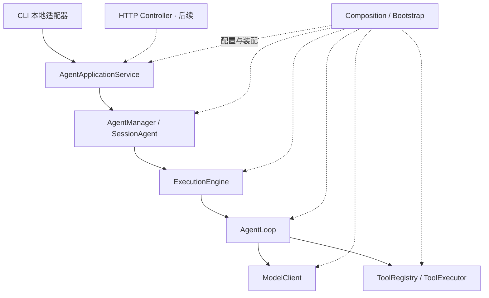

# Easy Agent 系统架构与项目骨架

> 本文是**当前有效架构基线**，只规定职责划分、边界和目录组织方向，不提前定义所有组件接口、状态机、事务协议或实现方式。项目级历史见 [变更记录](changes.md)；模块现行说明及局部历史见 `src/<module>/README.md`、`src/<module>/changes.md`。

## 1. 整体架构

Easy Agent 是**开箱即用、灵活可扩展的通用 Agent**，采用：

**四个核心运行职责层 + 横向 Harness 支撑 + Composition / Bootstrap 装配入口。**

```text
                     Composition / Bootstrap
                       配置、选择、装配、初始化
                                │
                                ▼
 ┌────────────────────────────────────────────────┐
 │ Application                                    │
 │ CLI / SDK / HTTP API / Web UI                  │
 ├────────────────────────────────────────────────┤
 │ Agent                                          │
 │ AgentManager / SessionAgent / Inbox / Scheduler│
 ├────────────────────────────────────────────────┤
 │ Execution                                      │
 │ Execution Engine（执行机制）                   │
 │ Agent Loop（执行策略）                         │
 ├────────────────────────────────────────────────┤
 │ Runtime                                        │
 │ Model / Tool / MCP / Skill / Memory            │
 │ Event / Persistence / Approval                 │
 │ Workspace / Sandbox / Resource                 │
 └────────────────────────────────────────────────┘

      Harness：横向提供 Contracts / Context / Extension
               Governance / Execution Services
```

这张图是**职责组织图，不是执行请求调用链**。Harness 不是 Execution 与 Runtime 之间的必经中间件；Composition / Bootstrap 负责装配，不负责运行用户任务。各模块通过必要的契约直接协作。

**Phase 0、Logging、Phase 1.1～1.6、Phase 2.1、Phase 2.2 已完成；[Phase 2.4](phase-2.4.md)（Persistence / Session Event Log / 冷启动重建）为本机（darwin）已落地基线，验收以阶段文档与实测为准；Phase 2.3 HTTP/SSE 仍暂缓。** 工程基线与历史验收见各阶段文档；实际能力与验收边界以模块文档和阶段记录为准。

## 2. 核心模块职责

| 模块                    | 核心职责                                                                | 不是它的职责                           |
| ----------------------- | ----------------------------------------------------------------------- | -------------------------------------- |
| Composition / Bootstrap | 读取配置、选择组件、依赖装配及初始化                                    | 调度用户任务、作出模型决策             |
| Application             | 提供 CLI、SDK、HTTP API、Web UI 等交互入口                              | 实现 Agent Loop 或直接承担模型执行策略 |
| Agent                   | Session、用户输入、任务与 Execution 协调                                | 决定模型选什么工具、执行底层 Tool      |
| Execution Engine        | 启动/管理 Loop、执行生命周期、执行控制                                  | 决定下一步模型行为                     |
| Agent Loop              | 根据上下文和结果决定执行步骤与停止条件                                  | 组件装配、服务提供商生命周期管理       |
| Harness                 | 统一契约、Context、Extension、Governance、Execution Services 等横向支撑 | 强制充当每次调用的中间节点             |
| Runtime                 | 模型、工具、存储、资源、运行环境等实际能力                              | 决定全局 Agent 执行策略                |

### 2.1 Application

提供用户和开发者入口。当前 Phase 1.6 实现统一 AgentApplicationService 和本地 CLI；HTTP/SDK/Web UI 为后续入口。Service 只委托 AgentManager / SessionAgent 的应用操作、验证入参与映射稳定错误，不保存第二份队列或历史。CLI 从 Bootstrap 获取 Service，未来 HTTP Controller 可复用同一 Service 而不复制装配或调度。

### 2.2 Agent

负责 Session 管理、输入接收及 Execution 协调。Phase 1.5 在 AgentManager/SessionAgent 中提供内存 Session 生命周期、上下文及每 Session FIFO；不为此引入独立全局 Scheduler 或持久化 Inbox。Inbox/Steer/Follow-up 与复杂调度保留长期定位，按后续授权落地。

SessionAgent 是 Engine 事件流的内部唯一消费者，任务从 submit 同步入队后独立推进；外部观察流单次消费、缓存有界，其关闭或溢出不取消/阻塞执行。任务开始时读取最新已提交上下文，仅成功且存在 updatedContext 时整体提交，再结算独立 result、放行下一项。

### 2.3 Execution

保留 **Agent Loop（策略）与 Execution Engine（机制）分离**。Loop 决定下一步动作和终止；Engine 负责通用执行生命周期、控制与资源清理。Phase 1.3 的官方策略为 DefaultAgentLoop；已完成的 DefaultExecutionEngine 通过通用 AgentLoop 契约驱动默认或自定义算法，管理内存状态、实时通知、结果、取消与快照，不决定模型或工具策略。

### 2.4 Harness

提供 Contracts、Context Management、Extension System、Execution Services、Governance 等横向支撑，**不是第五条纵向业务调用链**。模型、工具与 Loop 契约分别位于 `src/harness/contracts/model/`、`src/harness/contracts/tool/`、`src/harness/contracts/agent-loop/`，Execution 运行契约位于 `src/harness/contracts/execution/`；当前 Agent 管理契约落于 `src/harness/contracts/agent/`，直接复用前述类型。其他契约随真实能力落地，不建立巨型接口包。

### 2.5 Runtime

具体能力按领域划分，例如 Model、Tool、MCP、Skill、Memory、Event、Persistence、Approval、Workspace、Sandbox、Resource。**优先按单项能力替换**；不要求替换模型时重做全部 Runtime。`src/runtime/logging/` 已提供供应商无关的 Logger 门面。当前 `src/runtime/model/` 通过 Harness 的 ModelClient 契约提供 OpenAI-compatible Chat Completions、OpenAI Responses，以及启动期 Model Registry / Router；Composition 按 Provider `type` 选择工厂并按 Provider ID 创建独立实例。`src/runtime/tool/` 通过 ToolRegistry/ToolExecutor 契约提供独立工具注册、校验、`GuardedToolExecutor` 前置链、FileSystem/Terminal 内置工具与轻量模型数据桥接；`src/runtime/workspace/` 与 `src/runtime/approval/` 提供进程内 Workspace 锁/UNSAFE 与审批。模型与工具不自行互相调用，循环策略由 Execution 的 DefaultAgentLoop 实现，不放入 Runtime。

### 2.6 Composition / Bootstrap

提供统一配置与装配入口：在初始化边界解析配置（CLI 显式选项 > 环境变量 > 配置文件 > 默认值），选择默认或注入组件、连接依赖、初始化与释放。应用持有共享 Service 和幂等 dispose；退出先取消并等待既有执行收尾，再释放自有资源，初始化失败回滚。外部共享依赖的所有权独立，不建立复杂 DI 容器、全生命周期插件管理或热更新系统。

## 3. 核心设计原则

1. **职责分层不等于严格调用分层**：不强制运行请求顺次经过所有层。
2. **策略与机制分离**：Agent Loop 与 Execution Engine 不混合职责。
3. **依赖契约而不是默认实现**：Loop 不直接依赖特定模型 Provider，Runtime 实现对应能力契约。
4. **默认能力与扩展能力平衡**：先提供可运行的默认 Agent，再按真实需求开放替换点。
5. **避免过度设计**：不建立万能 Runtime、过度复杂的抽象、全组件插件化。
6. **组件架构不等于文件夹模板**：有业务代码时才创建相应源码；不为未来能力批量占位。

## 4. 执行实体与控制模型

已有 Engine 维护 Execution 的最小内存生命周期：RUNNING、COMPLETED、FAILED、CANCELLED。Agent 层已提供 Session 及内部队列/活动状态，不向 ExecutionStatus 添加 QUEUED；完整 Turn/Step/Attempt 及后续控制实体仍属未来设计。

| 概念      | 定位                               |
| --------- | ---------------------------------- |
| Session   | 持续交互上下文、执行记录和相关数据 |
| Execution | 一次完整执行生命周期               |
| Turn      | 一次 Agent 对输入的响应和处理      |
| Step      | Turn 内的逻辑执行步骤              |
| Attempt   | Step 的一次实际执行尝试            |

后续统一使用 Attempt 表示实际尝试，不把 Step 与 Retry 混在一起。

已确认的控制语义：

- **Follow-up**：进入 Inbox，后续创建新的 Execution；同一 Inbox Item 只关联一个创建的 Execution。
- **Steer**：针对正在执行的目标 Execution，在 Step 边界处理，不强制中断正在进行的模型请求和 Tool 调用。
- **Cancel**：与执行实体生命周期一致的取消控制。
- **Approval**：独立实体，通过引用关联 Step，审批通过不代表操作已成功执行。
- **Recovery**：基于已有事实核实和恢复，不改写已经发生的历史记录。

除既有 Execution 状态与本阶段 Session 协调外，完整状态机、审批协议、Session 事件事务边界等以后按对应模块授权讨论，**不在 Phase 1.6 实现持久化或恢复**。

## 5. Phase 1.6：当前工程目录与能力边界

Phase 0 已建立 Node.js 26.x / TypeScript / ESM 工程和六个一级职责模块的文档骨架。Logging、Model、Tool、AgentLoop、ExecutionEngine 和 Session 管理已形成可复用基线；Phase 1.6 在 Application/Composition 增加统一交互、默认装配与 CLI，保持既有公共契约：

```text
easy-agent/
├── AGENTS.md / .cursor/rules/easy-agent.mdc
├── README.md
├── docs/
│   ├── AGENT.md / architecture.md / conventions.md
│   ├── phase-0.md                 # 已完成的工程基线与历史验收
│   ├── phase-1.md                 # Phase 1 阶段顺序索引
│   ├── phase-1.1.md               # 已完成 Model System 基线与历史验收
│   ├── phase-1.2.md               # 已完成 Tool Runtime 基线与历史验收
│   ├── phase-1.3.md               # 已完成 Agent Loop 设计与历史验收
│   ├── phase-1.4.md               # 已完成 Execution Engine 设计与历史验收
│   ├── phase-1.5.md               # 已完成 Agent Management 与历史验收
│   ├── phase-1.6.md               # 当前唯一阶段依据
│   └── roadmap.md / changes.md
├── package.json / package-lock.json
├── tsconfig.json / tsconfig.build.json
├── eslint.config.js / .prettierrc.json / .prettierignore
├── .gitignore / .nvmrc
├── src/
│   ├── index.ts                   # 公共契约、Logger、Runtime、Loop/Engine 组件
│   ├── application/               # 统一 AgentApplicationService 与就近文档
│   │   └── cli/                   # 本地终端适配与可执行入口
│   ├── agent/                     # 内存 Session 管理与就近文档
│   ├── execution/
│   │   ├── loops/                 # 既有 DefaultAgentLoop
│   │   └── engine/                # DefaultExecutionEngine 与就近文档
│   ├── harness/
│   │   ├── README.md / changes.md
│   │   └── contracts/
│   │       ├── model/             # 既有模型公共契约与就近文档
│   │       ├── tool/              # 既有工具公共契约与就近文档
│   │       ├── agent-loop/        # 既有通用 AgentLoop 契约
│   │       ├── execution/         # 既有 Engine/Request/Event/Result/Snapshot 契约
│   │       └── agent/             # 既有 AgentManager/SessionAgent 等契约
│   ├── runtime/
│   │   ├── README.md / changes.md
│   │   ├── logging/               # 既有 Logger 门面、Pino 适配及就近文档
│   │   ├── model/                 # 既有模型 Adapter 与就近文档
│   │   └── tool/                  # Registry/Executor、Schema 校验与桥接
│   └── composition/               # 配置解析、Bootstrap、生命周期及安全演示工具
└── tests/                         # 工程与所有已实现模块的离线验证
```

- `ModelClient.generate()` 返回完整响应，`stream()` 返回异步事件流。公共契约不依赖 OpenAI SDK，不引入 Session、Turn 或执行实体。
- `ModelRequest.parameters` 统一承载标准参数和扩展参数。Adapter 做协议映射、冲突校验及错误归一，不执行工具或维护消息历史。
- ModelClient 是可复用实例。只共享固定配置及 HTTP 能力；每次调用独立持有响应、文本/工具增量缓存、AbortController 与超时状态，不使用全局锁串行化请求。
- ModelClient 使用既有 Logger 门面，默认提供统一日志并支持构造时注入。生命周期日志只记录诊断元数据，日志不成为响应事件或消息历史，也不泄露模型消息、工具参数和认证配置。
- 模型取消与超时属于单次模型请求；不等同于 Agent Execution 的取消、排队或恢复。
- ToolRegistry 保存防御性复制的声明；ToolExecutor 获取一次注册快照、严格校验对象参数并执行 Handler。注销或重注册不改变已开始的调用，各调用取消/超时独立，无全局锁或自动重试。
- Tool 业务失败返回 ToolResult，取消/超时抛出 ToolExecutionError；协作式取消不承诺终止任意代码或回滚副作用。Model Bridge 复用既有模型类型，不调用模型或执行循环。
- Harness AgentLoop 接口统一为 run(context) 的 AsyncIterable；自定义实现无需模型/工具。DefaultAgentLoop 通过已注入的 ModelClient/Registry/Executor 实现流式模型、串行工具、结果回填和再次模型调用。
- 默认策略从 Context 扩展读取，模型额外重试默认 2 且受已公开输出边界约束；工具不自动重试。没有模型/工具/迭代总次数上限，也没有默认全局超时。
- Loop 正常结果由唯一 loop_end 返回，默认策略保留完整历史，异常通过迭代抛出；Engine 校验 Loop 协议并在自然 EOF 后归一 Execution 终态，不重写 Loop 策略。
- Engine execute 是惰性、单消费者、单次消费的 AsyncIterable；启动前错误不产生事件或新快照。启动后通过 execution_start、loop_event、execution_end 输出实时通知。
- completed 映射 COMPLETED；stopped 映射 FAILED/loop_stopped 并保留 LoopResult。运行异常/协议违例使用安全错误结果，接受的取消请求在收尾后映射 CANCELLED；单次模型/工具 timeout 不自动视为取消。
- Engine 独立保存内存状态与有界终态快照，运行中记录不淘汰。复制普通数据图；外部函数/闭包/带私有状态对象保留能力引用，不承诺隔离这些对象的内部状态。
- 消费者提前退出请求取消并清理公开 Loop 迭代器与 Engine 自有资源；不能承诺已退出消费者收到末尾事件，不能强制结束任意更底层资源或回滚副作用。
- ExecutionEvent 是内存通知，不是持久化事实；当前不读写 Session Event Log JSONL，不创建事务日志、事件重放、恢复或 Runtime Event Bus/SSE；Session FIFO 由 Agent 层负责。
- Agent 层已统一 Session 生命周期、提交和内存 FIFO，不把调度放入 Engine 或 Loop；同 Session 在结果结算/上下文提交后才启动下一项，不同 Session 可并发。
- Session 内部消费与外部观察解耦，观察流关闭/溢出不取消任务，最终结果独立可取。仅成功的完整 updatedContext 提交；失败/取消不更新历史。
- Model、Tool、Loop、Engine 与 Manager 仍可独立复用；Composition 通过其已有构造函数装配，不调整既有签名。Service 和 CLI 不重复实现调度、上下文或 Loop 策略。
- `node_modules/` 和 `dist/` 为忽略的生成目录；私有单包结构、ESM 与工程工具链保持不变。本阶段通过统一 Service 与 Bootstrap 接入本地 CLI；Session 日志读写和持久化恢复仍未实现。
- 能力子模块随真实实现创建本地 README/changes，不为其他未来能力建立空目录或占位接口。

Logging 配置与安全规则见 [Runtime Logging](../src/runtime/logging/README.md)。模型细则见 [Model Contracts](../src/harness/contracts/model/README.md) / [Runtime Model](../src/runtime/model/README.md)，工具细则见 [Tool Contracts](../src/harness/contracts/tool/README.md) / [Runtime Tool](../src/runtime/tool/README.md)，Loop 规则见 [Phase 1.3](phase-1.3.md) 与 [Execution Loops](../src/execution/loops/README.md)；Engine 基线见 [Phase 1.4](phase-1.4.md) 和 [Execution Engine](../src/execution/engine/README.md)。Agent 行为见 [Phase 1.5](phase-1.5.md)、[Agent 模块](../src/agent/README.md) / [Agent Contracts](../src/harness/contracts/agent/README.md)。当前唯一阶段依据为 [Phase 2.1](phase-2.1.md)，应用接口与装配细节分别见 [Application](../src/application/README.md) 和 [Composition](../src/composition/README.md)。

## 6. 应用入口与后续扩展

本地 CLI 调用链与装配边界：



CLI 本地模式不经过 HTTP。Service 不依赖终端、HTTP 或 Runtime；Bootstrap 负责组件选择与生命周期，不是新业务层。Session ID、Execution ID 和 FIFO 继续由 Agent 分配/调度，CLI 不接管。正文展示仅消费 output_delta，最终 result 独立获取；退出观察不等于取消。

未来 HTTP 可接入同一个应用实例的 service，不预先固定路由、SSE 或远程协议。

Session Event Log 的物理读写唯一归 Runtime/Persistence，Engine/Agent 未来只提交领域事实。可靠提交、序列、幂等和“提交后发布”时序留待后续设计；不能把当前 AsyncIterable 直接接到 JSONL 写入器就宣称具有事件溯源或恢复能力。

### 后续扩展目录方向（Phase 2/3+）

```text
 src/
   application/http/             # HTTP / SSE
   application/sdk/              # SDK 入口
   agent/inbox/                  # Follow-up / Steer
   agent/scheduler/              # 排队与调度
   execution/recovery/           # 恢复
   harness/context/              # Context Management
   harness/extension/            # Extension System
   harness/governance/           # Governance
   runtime/mcp/
   runtime/skill/
   runtime/memory/
   runtime/event/
   runtime/persistence/
   runtime/approval/
   runtime/workspace/
   runtime/sandbox/
   runtime/resource/
```

Persistence、Event、Extension、Governance 为跨模块能力或能力域，不需要额外提升为新的顶级产品层。

## 7. 代码依赖约束

当前模型、工具、Loop/Engine、Agent、Application/Composition 与后续功能开发均遵循：

- `application/cli` 只通过 Bootstrap 获取统一 AgentApplicationService，Service 只依赖 Agent 公共契约，不直接访问模型、工具、Loop 或 Engine。
- `agent` 协调 Execution，不把 Loop 的决策策略放进 SessionAgent。
- `execution/loops` 依赖 ModelClient/Tool 契约，不直接依赖具体 Provider 实现；`execution/engine` 只依赖通用 AgentLoop，不耦合默认算法。
- Engine 当前只维护内存运行事实，不直接访问 Session Event Log 或承担未来 Persistence/Event 实现。
- `runtime/model` 实现能力契约，不反向依赖 CLI。
- `composition` 负责集中选择和装配默认实现，可依赖其装配所需的实现。
- 读取环境变量及密钥仅发生在明确的配置边界，核心 Loop 不读取环境配置。

**本阶段只增加 Application Service、Composition / Bootstrap、本地 CLI 与离线集成，不授权创建 HTTP/Persistence 等后续组件。**

## 8. 设计判断与后续更新

如果抽象没有当前使用者、明确契约需求或实际验证依据，优先不实现。如果必须调整已经确认的架构，应先说明为什么调整及影响，再确认方案。

现行架构文档只描述最新有效方案；每次实质性调整的背景、前后差异与时间线单独追加到 [changes.md](changes.md)。

## 9. 模块级文档与源码的组织关系

文档粒度优先采用**职责明确、可以单独开发和维护的模块**，不要求每个源文件都有文档，也不因为独立 npm package 尚未拆分就把所有说明集中到根目录。

- **一级模块**：`src/application`、`src/agent`、`src/execution`、`src/harness`、`src/runtime`、`src/composition` 均必须有自己的 `README.md` 与 `changes.md`，Phase 0 即交付。
- **独立子能力**：例如当前的 `src/runtime/model`、`src/execution/loops`，以及 `src/application/cli`，若已形成独立职责与开发范围，随代码落地本地文档。普通工具代码、组织性目录不必另建两份文档。
- **独立 package**：如果未来真实拆分成 `packages/<name>`，模块文档跟随其 package 根目录；这是**位置变化**，不是必须先上 Monorepo 的理由。
- **文档权威性**：`docs/architecture.md` 管全局职责与依赖，模块 `README.md` 管当前模块实现，模块 `changes.md` 管本模块修改历史，`docs/changes.md` 管全局/跨模块历史。

在某模块实施任务前，Coding Agent 首先读取离该任务最近的模块说明和变更记录，再按需查阅父模块及直接依赖，不必每次把所有文档加载到上下文。
