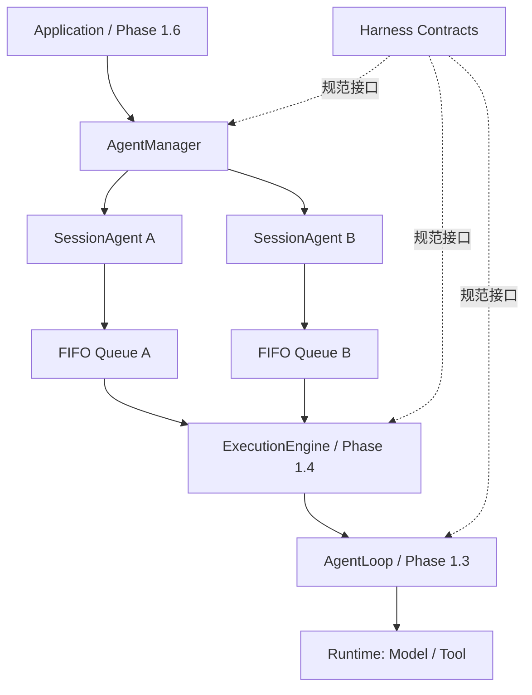

# Easy Agent — Phase 1.5 Agent Management 技术方案与 Coding Agent 开发任务书

> 版本：V1.0（2026-11-23）  
> 阶段：Phase 1.5  
> 状态：**2026-11-24 已完成 Phase 1.5-A～E；五项工程检查通过，216 项测试通过、0 失败、0 跳过**  
> 前置依赖：Phase 1.1 Model System、1.2 Tool Runtime、1.3 Agent Loop、1.4 Execution Engine（均已由项目方完成开发）  
> 文档定位：**当前 Phase 1.5 唯一有效的设计与开发任务依据**。既有 Phase 1.1～1.4 已实现的 Harness 公共契约与现行模块文档仍然有效；本任务书不能静默覆盖它们。

> 本文保留 Phase 1.5 已完成的设计与 216 项历史验收。当前阶段转为 [Phase 1.6 Application Service / Composition / CLI](phase-1.6.md)，不覆盖以下当时的交付边界。

## 1. 产品目标与本阶段交付

Easy Agent 是一个**开箱即用、灵活可扩展的通用 Agent**，坚持 **Easy to Use / Easy to Extend**。本阶段将已实现的 Loop 与 Engine 组织为可用于多轮交互的 Session Agent，不引入与当前闭环无关的系统。

**交付一个可离线验收的 Agent Management 最小闭环：**

1. 创建、获取、列出、删除 Session。
2. 每次用户输入创建一个唯一 Execution，并在 `submit()` 调用时立即登记到 FIFO 队列。
3. 同一 Session 至多一个执行中的 Execution；不同 Session 允许并发。
4. Session 在任务实际开始时注入当时最新上下文；成功后更新上下文，失败/取消则不提交。
5. 支持 Session 默认配置和单次提交配置覆盖；调用 Phase 1.4 `ExecutionEngine` 驱动任意实现 Harness `AgentLoop` 的 Loop。
6. 单次提交同时返回可观察的实时事件流和独立可等待的最终结果。
7. 支持取消排队任务或运行中的任务，并合理处理事件不消费、消费提前结束及事件缓冲溢出。
8. 提供可复用的默认实现、离线测试、README 与 changes.md。

**明确不在 Phase 1.5 实现：** Session Event Log JSONL 读写、Transaction Journal、Session Write Coordinator、崩溃恢复、Memory、Context Compression、持久化 Inbox、Steer、Follow-up、Approval/HITL、Session Tree、Workspace 资源管理、复杂任务优先级/全局调度、CLI/HTTP/SSE/Web UI。这些保留原有总体架构定位，在后续阶段实施。不得因本阶段暂缓而否定已确认的长期设计。

## 2. 最顶层设计原则与责任边界

**Harness 提供契约；Agent、Execution、Runtime 等模块实现或消费契约。Harness 不是必须逐层调用的纵向业务层。**



| 模块                                 | 在 Phase 1.5 的职责                                                                                 |
| ------------------------------------ | --------------------------------------------------------------------------------------------------- |
| Harness                              | `AgentManager`、`SessionAgent`、`SessionExecution`、配置/摘要等公共接口；不能绑定默认实现的内部细节 |
| AgentManager（Agent）                | Session 创建、注册、获取、列出和删除；复用依赖和 Session ID 生成                                    |
| SessionAgent（Agent）                | Session 上下文、配置、提交、FIFO 队列、取消与结果收敛                                               |
| ExecutionEngine（Execution，已实现） | 单次 Execution 生命周期、Loop 驱动、取消、异常映射及 ExecutionEvent；仍按 Phase 1.4 契约运行        |
| AgentLoop（Execution，已实现）       | 决定执行策略、模型/工具调用、返回 `AgentLoopResult`；不管理 Session 队列                            |
| Runtime / Persistence（后续）        | Session Event Log 物理读写、事务、Sequence、历史读取；本阶段不接入                                  |
| Runtime / Event（后续）              | 跨订阅者分发和 SSE；本阶段仅单执行句柄观察流                                                        |

**特别强调：** SessionAgent 对 Execution Engine 的 `AsyncIterable` 是**内部唯一主动消费者**。外部拿到的 `SessionExecution.events` 是 Agent 层观察流，而不是直接透传 Engine 的迭代器。否则外部不消费事件时任务就不会执行，也无法保证按 `submit()` 调用顺序 FIFO。

## 3. 依赖与兼容规则

请在编码前查看仓库实际定义，确保与以下已确定的上游形状兼容（此处仅摘录必要部分，**不要重新定义或复制上游接口**）：

```typescript
// Phase 1.3，实际使用仓库导出的 AgentLoopContext / AgentLoop
interface AgentLoop {
  run(context: AgentLoopContext): AsyncIterable<AgentLoopEvent>;
}
// AgentLoopContext = { input: {content}, context: {messages, data?},
//   config: {model?, tools?, extensions?}, control: {signal}, metadata? }
// AgentLoopResult.status = "completed" | "stopped";
// AgentLoopResult.updatedContext? 为完整上下文快照；缺省表示没有更新。

// Phase 1.4，实际使用仓库导出的 ExecutionEngine / ExecutionResult 等
interface ExecutionEngine {
  execute(request: ExecutionRequest): AsyncIterable<ExecutionEvent>;
  cancel(executionId: string): boolean;
  getSnapshot(executionId: string): ExecutionSnapshot | undefined;
}
// ExecutionRequest = { executionId, loop, context }
// ExecutionResult.status = "COMPLETED" | "FAILED" | "CANCELLED";
// ExecutionEvent.type = "execution_start" | "loop_event" | "execution_end";
```

- Phase 1.4 的 `execute()` 是**惰性启动、单消费者、一次性消费**：首次开始读取其事件时启动执行。
- 调用方直接退出 Phase 1.4 的原始执行事件流会请求取消 Execution。**Agent 层的观察者提前退出不应触发这一行为**，因为 Agent 层内部消费者仍在运行。
- `execution_end.result` 是 Engine 的最终结果来源；Agent 层不能凭模型文本自行推断成功。
- 若仓库实际导出或行为与上述设计存在重大差异，先报告精确冲突及最小兼容方案，**不得擅自修改 Phase 1.1～1.4 公共契约**。

## 4. Harness 公共契约（Phase 1.5-A）

以下为目标接口。类型声明落到仓库现有的 Harness/Agent Contracts 目录，按项目现有导出规范组织；不要为了目录样式新建第二套平行契约。

### 4.1 AgentManager

```typescript
export interface AgentManager {
  createSession(options?: CreateSessionOptions): SessionAgent;
  getSession(sessionId: string): SessionAgent | undefined;
  listSessions(): SessionSummary[];
  deleteSession(sessionId: string): Promise<boolean>;
}
```

- `createSession()` 同步创建内存 Session 并注册；返回稳定的 SessionAgent 实例。
- `getSession()` 返回同一存活实例；不存在则 `undefined`。
- `listSessions()` 返回安全快照（非内部 Map/队列引用）；创建顺序稳定。
- `deleteSession()` 在 Session 有运行中或排队中 Execution 时返回 `false`，不自动取消；空闲时删除并释放管理引用返回 `true`；不存在返回 `false`。不得静默丢弃任务。
- Session ID 由 AgentManager 生成；每次提交的 Execution ID 由 Agent Layer 生成，满足 Engine 唯一性规则。

### 4.2 SessionAgent 与 SessionExecution

```typescript
export interface SessionAgent {
  readonly sessionId: string;

  submit(input: string, options?: SessionSubmitOptions): SessionExecution;

  getContext(): AgentLoopContext['context'];
  cancel(executionId: string): boolean;
}

export interface SessionExecution {
  readonly executionId: string;
  readonly events: AsyncIterable<ExecutionEvent>;
  readonly result: Promise<ExecutionResult>;
}
```

- `submit()` **同步**完成输入校验、生成 Execution ID、登记队列、返回句柄，不等待模型或事件消费者。
- `events` 是当前提交的**单消费者、只允许遍历一次**的观察流，类型沿用 `ExecutionEvent`，不修改 1.4 协议。
- `result` 与 `events` 消费完全独立：即使从未读取事件，任务仍执行、结果仍可获得。
- `result` 在本阶段**总是 resolve 为标准 `ExecutionResult`**（包括 `FAILED`/`CANCELLED`），不将正常执行失败作为 Promise rejection；提交时输入不合法可同步 throw。
- `getContext()` 返回 Session 当前已提交的上下文**副本/只读快照**，不能暴露 Agent 内部可变引用。
- `cancel()` 接受本 Session 中待执行或运行中的 ID；对其他 Session、不存在、已完成 ID 返回 `false`。`true` 代表取消请求已受理，不代表已经进入终态；重复取消活动任务可幂等返回 `true`。

### 4.3 创建、配置与摘要

```typescript
export interface CreateSessionOptions {
  /** 可选：省略时使用 AgentManager 注入的默认 Loop */
  loop?: AgentLoop;
  /** 创建时提供的上下文基线；省略为 { messages: [] } */
  context?: AgentLoopContext['context'];
  /** 本 Session 的默认执行配置，兼容自定义 Loop */
  config?: AgentLoopContext['config'];
}

/** 覆盖部分 Session 默认配置，具体合并规则见第 6 节 */
export interface SessionSubmitOptions {
  config?: {
    model?: {
      name?: string;
      parameters?: ModelParameters;
    };
    tools?: {
      allowedNames?: readonly string[];
    };
    extensions?: Readonly<Record<string, unknown>>;
  };
}

export interface SessionSummary {
  sessionId: string;
  createdAt: string;
  runningExecutionId?: string;
  queuedCount: number;
}
```

- `ModelParameters` 仅引用 Phase 1.1 已有类型。
- `config.model` 不强制必填：自定义 AgentLoop 可能完全不使用模型。默认 Loop 对模型名的校验仍由 Phase 1.3 负责。
- Session 级 Loop 在创建时确定；本阶段不支持 `submit()` 临时替换 Loop，以免引入复杂的切换规则。未来可通过 Composition 扩展。
- `SessionSummary` 提供 Session 排队与运行状态的基本观察，不承诺完整 Execution 状态机。
- 始终保持 Harness 公共契约与默认实现的可替换性：其他 `AgentManager`/`SessionAgent` 实现可自行组织内部逻辑，只需遵循接口语义。

## 5. Session 生命周期与 FIFO（Phase 1.5-B/C/D）

### 5.1 提交立即入队；消费只负责观察

```mermaid
sequenceDiagram
    participant App as Application
    participant SA as SessionAgent
    participant Q as Session FIFO
    participant EE as ExecutionEngine
    participant Loop as AgentLoop
    App->>SA: submit(input)
    SA->>Q: 生成 executionId + 入队
    SA-->>App: {executionId, events, result}
    Note over App,SA: 不要求 App 开始消费 events
    Q->>SA: 获取队首执行
    SA->>SA: 读取最新 Session Context + 合并 Config
    SA->>EE: execute({executionId, loop, context})
    SA->>EE: for await 事件（内部主动消费）
    EE->>Loop: run(context)
    Loop-->>EE: AgentLoopEvent...
    EE-->>SA: ExecutionEvent...
    SA-->>App: events（可选观察）
    EE-->>SA: execution_end(result)
    SA->>SA: 若 COMPLETED，提交 updatedContext
    SA-->>App: result Promise resolve
    SA->>Q: 开始下一项
```

**FIFO 定义**：以同一个 SessionAgent 上 `submit()` **成功完成入队登记的顺序**为准，与外部调用方何时消费 `events`、何时 await `result` 无关。

1. 每 Session 单独维护 `pendingQueue` 和 `activeExecution`，仅允许一个调度泵（pump）运行，防止重复并发启动。
2. `submit()` 在同步上下文中把任务加入队列；然后安排调度泵启动。不得在入队前 `await`。
3. 每次取队首时重新读取当前已提交上下文，构建本次输入与有效配置的快照。
4. 真正需要执行时，内部调用并**持续消费** `ExecutionEngine.execute(request)`；直到 `execution_end`、迭代自然结束或发生错误。
5. 收敛最终结果、提交上下文、清理 active 状态后，再启动下一个任务。
6. 某项任务 FAILED/CANCELLED 不应默认阻塞后续排队任务；后续任务使用最后一次成功提交的上下文。
7. 不同 Session 独立调度，允许复用同一个 ExecutionEngine、ModelClient、Tool Runtime，且不会全局串行化。

### 5.2 QUEUED 是 Agent 调度状态

- Phase 1.4 的 `ExecutionStatus` 不包含 `QUEUED`，**不要为了排队修改 1.4 的 Engine 状态机**。
- SessionAgent 内部自行表示 `QUEUED / RUNNING / SETTLED` 等调度状态；是否导出内部状态类型由现有仓库规范决定，不需要新增公共 ExecutionStatus。
- 对于尚未交给 Engine 的排队任务，`ExecutionEngine.getSnapshot(id)` 可以返回 `undefined`，这不是错误；Session 队列才是其信息来源。

### 5.3 取消排队任务

- 在本 Session 的队列中找到目标，原子地移除/标记为已取消，不启动 Engine、Loop 或模型/工具调用。
- 将 `SessionExecution.result` resolve 为 `{ status: "CANCELLED", reason: "cancelled_while_queued" }`。
- 观察流正常结束（可以没有任何 `ExecutionEvent`），**不伪造** Engine 未实际产生的 `execution_start`/`execution_end`。
- 不更新上下文；后续任务按原 FIFO 顺序继续。
- 与调度泵争夺同一任务时，确保只有一个分支取得所有权，最终结果只结算一次。

### 5.4 取消运行中任务

- 为每个提交创建独立 `AbortController`；在实际启动时传入 `AgentLoopContext.control.signal`，Engine 再按照 Phase 1.4 合并控制信号。
- 如果仍在运行中，`cancel()` 触发该控制器 `abort()`，并可调用 `ExecutionEngine.cancel(executionId)` 作补充；不因 `Engine.cancel()` 短暂返回 false（惰性启动竞态）而漏取消。
- 最终状态来自 Engine 的 `execution_end`，正常应为 `CANCELLED`。仅当 Engine 已确实先完成时才可保留已确定的终态，不能由取消请求回写覆盖终态。
- 对方未及时响应取消时属于协作式取消，不承诺立刻停止外部副作用；不得在后台仍执行时启动同 Session 下一项。
- 完成后的取消请求不改变历史结果。

### 5.5 Session 删除与资源清理

- 有任意活跃任务或有效排队任务时 `deleteSession()` 返回 `false`，Session 继续存在。
- 空闲后允许删除；删除后不再通过 Manager 获取 Session，已结算的 `SessionExecution.result` 不受影响。
- 本阶段不实现“强制删除并级联取消”，也不自动清理仍被外部代码持有的 SessionAgent 引用；若需要使已删除对象拒绝后续提交，默认实现应标记 `closed` 并同步拒绝后续 `submit()`。
- `listSessions()` 不包含已删除 Session。

## 6. 多轮上下文和配置

### 6.1 Context 读取与提交

Session 内保存**上一次已成功提交**的 `AgentLoopContext["context"]`。每次启动新任务时：

```typescript
const loopContext: AgentLoopContext = {
  input: { content: submittedInput },
  context: cloneCommittedContext(),
  config: resolveConfig(sessionConfig, submitOptions?.config),
  control: { signal: submissionAbortController.signal },
  metadata: { sessionId, executionId },
};
```

- `input.content` 只表示本次输入；历史 `context.messages` 不重复包含当前输入。
- **不得在 submit 时提前读取历史**，否则排队任务会读到陈旧上下文。
- 当 `ExecutionResult.status === "COMPLETED"` 且 `loopResult.updatedContext` 存在时：原子替换整个 Session 上下文快照；这是**完整快照**，不是合并差量。
- 当 `COMPLETED` 但 `updatedContext` 缺省时：保留既有上下文。**不得**自行拼接模型消息或猜测自定义 Loop 的历史结构。
- 当 `FAILED` / `CANCELLED`：不提交本次执行产生的上下文，包括 `loopResult.status === "stopped"` 时即使附带 `updatedContext` 也不提交。
- 上下文快照应隔离可变引用：创建时输入、传入 Loop 的上下文及 `getContext()` 返回值均不可借助共享对象引用改写 Session；至少对标准消息、工具调用、参数数组与 JSON-like `data` 做防御性复制/校验。
- 无 Session Event Log 或持久化，进程终止后本阶段的上下文会丢失，这是已知范围边界。

### 6.2 配置有效值解析

优先级：**本次提交覆盖 > 创建 Session 时默认值**。不从文件或全局配置隐式读取并修改已存在 Session 的默认值。

具体规则：

1. `model.name`：单次提交提供时覆盖默认模型名。
2. `model.parameters`：按参数键合并，同名键由本次提交覆盖；与 Phase 1.1 `ModelParameters` 保持兼容。
3. `tools.allowedNames`：若本次显式提供则整组替换，`[]` 代表本次不允许工具；未提供则继承。
4. `extensions`：按命名空间键合并；**若某个命名空间本次提供，则整体替换该命名空间的值**，不对内部不透明的自定义配置进行递归深合并。
5. 配置应作为本次运行的独立快照，禁止修改 Session 默认配置或提交参数原对象。
6. Loop 专属配置（如 `extensions.defaultAgentLoop.maxModelRetries`）继续由对应 Loop 解释。Agent 层不新增模型调用总次数、ToolCall 总数或 Loop 循环上限。

示例：

```typescript
// Session 默认
{
  model: { name: "model-a", parameters: { temperature: 0.3, maxOutputTokens: 2048 } },
  extensions: { defaultAgentLoop: { maxModelRetries: 2, modelTimeoutMs: 30000 } }
}

// 本次提交仅改温度及重试策略
{
  model: { parameters: { temperature: 0.7 } },
  extensions: { defaultAgentLoop: { maxModelRetries: 0 } }
}

// 结果：模型仍为 model-a，maxOutputTokens 仍为 2048；
// defaultAgentLoop 命名空间被整体替换，modelTimeoutMs 不自动继承。
```

## 7. 事件观察流、背压与结果 Promise（Phase 1.5-D）

这一节是本阶段**必须实现的工程行为**，不能用“直接返回 Engine.execute()”代替。

### 7.1 内部执行驱动与外部观察必须解耦

```text
ExecutionEngine.execute() --内部 for-await 消费--> SessionAgent Pump
                                                    ├── result settle / context commit
                                                    └── 有界事件缓存 -> SessionExecution.events
```

- Engine 的 AsyncIterable 只能由 SessionAgent 内部调度器消费一次，确保 Engine 正常启动/清理。
- Agent 观察流可以晚于任务开始才被消费；此时读取此前缓冲的事件（在容量内）。
- 外部观察者 `break`/`return()` 只**关闭该观察流**、释放相关缓存；**不取消** Execution，也不阻塞 `result`。
- 若上层想取消任务，必须显式调用 `SessionAgent.cancel(executionId)`；不要把“客户端不看事件”误认为“用户要取消”。
- 本阶段每个 `SessionExecution.events` 仅支持**一个消费者、一次完整遍历**。多订阅者广播留给 Runtime / Event。

### 7.2 有界缓冲与溢出策略

为避免客户端不消费事件造成无限内存增长，默认 Agent 实现应提供可配置的 `eventBufferCapacity`（建议默认 **512 条事件**，按条数而非 Token 数计；这是默认实现配置，不进入 Harness 公共强制字段）。

**明确选择：溢出只使观察流失败，不使 Execution 失败。**

1. 内部驱动器收到 ExecutionEvent 时尝试投递到观察流；当无待处理 reader 且未消费事件数达到容量时，标记该观察流为 overflowed。
2. 停止向该观察流缓存后续事件，释放其队列内占用；后续读取事件流时抛出 Agent 层明确的 `SessionEventBufferOverflowError`（名称可按代码规范选择，但必须可识别），不静默丢数据。
3. **不得**等待事件缓冲出现空间而阻塞 Engine 内部消费；否则外部不读取时任务无法完成，也会阻塞同 Session 队列。
4. `SessionExecution.result` 仍正常 resolve 为 Engine 最终结果，Session 上下文仍依照执行结果提交，队列继续运行。
5. 外部提前关闭观察流后不再进行缓冲；不影响执行。执行正常结束且缓存未溢出时，剩余事件可被消费完毕，之后迭代结束。
6. 如果队列任务在启动前被取消，其观察流直接完成且无需伪造 ExecutionEvent。

本阶段事件流不是 Session Event Log，不承诺 durable replay。未来 SSE/Event Bus 将另行设计消费者订阅和持久化读取的分离边界。

### 7.3 结果结算顺序与安全

- Engine 输出 `execution_end` 后，SessionAgent 仍需确认底层迭代实际结束并完成 Engine 清理（以 Phase 1.4 的实现语义为准）。
- **先**确定终态和提交上下文，**再** resolve `SessionExecution.result`，**之后**放行同 Session 下一项。
- 运行流异常抛出、缺少 `execution_end`、出现重复终止事件等不应导致悬挂的 Promise。Agent 层统一收敛为 `ExecutionResult {status:"FAILED",error:{code:"internal_error",message:...}}`；不要伪造并未从 Engine 发出的生命周期事件。
- 内部异步调度必须捕获自身异常，防止未处理 Promise rejection；也不能通过吞掉异常来伪造 `COMPLETED`。
- 多次完成/取消竞争时，只能结算一次；最后结果不可反复修改。
- 当 observer 自身溢出或关闭，最终结果与上下文事务性顺序仍不受影响。

## 8. 推荐实现组织（以仓库实际结构为准）

```text
src/
  harness/
    ... agent contracts / public exports ...
  agent/
    README.md
    changes.md
    default-agent-manager.ts
    default-session-agent.ts
    session-fifo-scheduler.ts       # 仅在有必要时拆分
    session-event-buffer.ts        # 仅在有必要时拆分
    ... tests ...
```

建议保持三个分离的内部关注点，而不是为了抽象而额外引入大量 Service：

1. **Manager**：Session 生命周期、资源/依赖引用、ID。
2. **SessionAgent**：单 Session FIFO、上下文、取消与结果收敛。
3. **有界观察流**：可独立测试的队列与异步迭代器工具（可内聚在模块中）。

`DefaultAgentManager` 建议由 Composition 在 Phase 1.6 装配，构造时注入共享 `ExecutionEngine` 与默认 `AgentLoop`；Phase 1.5 不新建 Composition 配置文件、CLI 或 HTTP 接口。默认 Loop 为组件实例而非每次 submit 都新建。实例上的**每 Session、每提交的可变状态**必须独立。

本阶段不需要为测试引入网络模型或真实工具；使用确定性的 FakeAgentLoop、FakeExecutionEngine 或基于既有 Engine 的轻量替身即可。可通过实现内部构造选项注入 ID 生成器、缓冲上限或时间来源，避免把这些测试设施强行提升为 Harness 公共能力。

## 9. Coding Agent 开发任务与实施顺序

### 9.1 编码前检查（必须先做）

1. 阅读根目录 `AGENTS.md`，以及 `docs/AGENT.md`、`docs/architecture.md`、`docs/conventions.md`、`docs/phase-1.md` 和相关模块 README/changes.md（若路径存在，遵循仓库实际结构）。
2. 检查 Phase 1.3 `AgentLoopContext` / `AgentLoopResult` 及 Phase 1.4 `ExecutionEngine` / `ExecutionEvent` / `ExecutionResult` 的真实导出路径、类型和运行语义。
3. 确定 Harness 与 Agent 模块现有组织方式、工程脚本和测试框架；复用已有工程基础设施。
4. 如发现与本阶段目标存在阻断性的接口冲突，先给出差异、最小修改方案和影响范围，**不要自行修改之前阶段已确认契约**。

### 9.2 Phase 1.5-A：Harness Agent Management Contracts

- 定义并导出 `AgentManager`、`SessionAgent`、`SessionExecution`、`CreateSessionOptions`、`SessionSubmitOptions`、`SessionSummary`。
- 类型只引用上游已有 `AgentLoop` / `ExecutionEngine` 契约，不复制 `ModelMessage` 或 `ExecutionEvent` 定义。
- 明确接口文档注释（特别是 submit 即入队、result 独立、观察流单消费者、cancel 语义）。
- 编写接口级类型检查/契约用例。

### 9.3 Phase 1.5-B：DefaultAgentManager

- 注入共享 Engine、默认 Loop，创建 Session 实例；实现注册、查询、稳定列表、空闲删除。
- 保证 Session ID / Execution ID 全局唯一性及 Engine 不重复注册。
- 处理 Session 已删除对象的提交拒绝；返回安全摘要快照。
- 不把 Session 文件持久化、Workspace 管理或 Context Manager 提前引入本阶段。

### 9.4 Phase 1.5-C：SessionAgent 上下文与配置

- 实现当前 Session Context 的安全快照和只读语义。
- 实现 Session 默认配置及单次提交覆盖规则。
- 仅在执行前创建 `AgentLoopContext`，注入 `input`、`metadata`、独立 signal 和有效配置。
- 仅 `COMPLETED` 且 `updatedContext` 存在时替换上下文；其他情况保持不变。
- 多轮连续执行必须证明后一轮看见前一轮提交的历史。

### 9.5 Phase 1.5-D：调度、取消、事件及结果

- 实现每 Session 的 FIFO 调度泵，submit 同步排队、内部主动消费 Engine 流。
- 实现 queued cancel 与 running cancel，处理启动/取消竞态及协作式清理。
- 实现有界观察流与明确 overflow 错误；观察者退出不取消执行。
- 实现 result Promise 独立结算，不遗漏失败路径，不产生未处理 rejection。
- 验证不同 Session 并发、同 Session 串行；异常不使队列永久卡住。

### 9.6 Phase 1.5-E：测试、文档与验收

- 增加离线单元/集成测试，覆盖第 10 节验收场景。
- 每个**逻辑模块**维护本模块 `README.md`（现状/职责/接口/边界/用法）与 `changes.md`（时间、修改前后、原因、影响、验证）。按项目规范更新跨模块变更汇总。
- 保持现行设计文档反映当前实现；若多次调整，同一功能的变更必须按时间顺序可追溯。
- 执行仓库已有类型检查、Lint、格式检查、测试和构建脚本，不能凭空编造命令成功结果。

## 10. 离线测试与验收标准

以下 30 项已按实际测试及文档/契约差异检查验收；可复制数据与外部不透明能力的隔离边界见 [交付与限制说明](#131-实际交付与兼容边界)。

### 10.1 Manager 与 Session 生命周期

- [x] 新建 Session 可由 getSession 获取同一实例；listSessions 返回稳定且不可变的摘要。
- [x] 不同 Session ID 唯一；同 Session 不同 Execution ID 唯一；Engine 不收到重复 executionId。
- [x] 空闲 Session 删除成功；运行或排队时删除被拒绝且不影响任务。
- [x] 删除后查找不存在、列表不包含；旧 SessionAgent 引用无法再 submit。

### 10.2 FIFO 与并发

- [x] 同 Session 连续 submit A/B/C，无人消费事件时仍按 A→B→C 依次执行。
- [x] A 未结算前 B 不启动；A 完成后 B 启动时获取最新上下文。
- [x] A FAILED/CANCELLED 后 B 仍可执行；Context 未被 A 的未完成状态污染。
- [x] 不同 Session 的任务确实允许并发，不存在不必要的全局互斥。
- [x] 同时高频 submit 不出现双 pump / 并发重复启动。

### 10.3 上下文与配置

- [x] 默认空历史；首轮 completed 更新后，次轮能读到新的消息历史。
- [x] `COMPLETED` 但无 updatedContext 保留旧上下文。
- [x] FAILED / CANCELLED / Loop stopped 映射 FAILED 时均不提交 updatedContext。
- [x] 传入对象、Loop 收到的对象、getContext() 返回值互不造成共享可变污染。
- [x] 配置覆盖按模型名、参数、工具名单、extensions 命名空间规则精确生效。
- [x] 可创建使用 CustomAgentLoop、无模型配置的 Session；Agent 层不强制依赖默认 Loop 的模型策略。

### 10.4 观察流与最终结果

- [x] submit 后即开始独立调度；不读取 events，仅 await result 可以拿到终态。
- [x] 消费 events 时按 Engine 原始事件顺序观察；result 与 execution_end.result 一致。
- [x] 观察者 break/return 不取消内部 Execution；任务继续完成、result 正常 resolve。
- [x] 事件读取慢或无人读取且超过容量时，观察流明确抛 overflow 错误，result 仍可正常获取、下一任务继续。
- [x] 未溢出时，任务结束后仍可完整读到缓存的事件并正常结束。
- [x] 重复消费同一 events 明确拒绝，不重启 Execution。

### 10.5 取消、失败与资源

- [x] 排队取消立即 resolve CANCELLED，未调用 Engine，不伪造 Engine 事件，不污染上下文。
- [x] 运行中取消发出 AbortSignal，等待 Engine 收尾后才认为最终取消；重复取消幂等。
- [x] 取消/启动竞态最终只结算一次，不漏取消、不启动下一项过早。
- [x] Engine 抛异常、提前自然结束、缺失 execution_end 时，result 均 resolve FAILED，Session 可继续处理下一项。
- [x] 终态后 cancel 返回 false，不回写最终结果。
- [x] 事件队列大小有硬上限，不产生无人处理的异步任务或 Promise rejection。

### 10.6 阶段与工程边界

- [x] 无 Session Event Log JSONL 读写、无 Transaction Journal、Session Write Coordinator 或 Recovery 代码。
- [x] 不修改 Phase 1.1～1.4 公共接口（重大冲突除外，需先报告）。
- [x] 文档 README/changes.md 按时间线记录；类型检查、格式检查、Lint、构建、测试符合仓库已有要求。

## 11. 最终交付报告格式

Coding Agent 完成后，应按以下结构报告：

1. **完成范围**：1.5-A/B/C/D/E 的实现清单。
2. **变更文件**：按 Harness/Agent/测试/文档分类列出实际路径。
3. **关键语义**：提交/消费解耦、FIFO、上下文提交、排队取消、运行取消、观察流溢出处理。
4. **验收记录**：每项测试的通过/失败/未运行及实际命令输出摘要。
5. **兼容情况**：是否修改 Phase 1.1～1.4 公共契约；若有冲突、如何处理。
6. **文档更新**：README、changes.md、跨模块决策记录。
7. **未开发范围**：明确 Session Event Log、Inbox、Recovery、Workspace、CLI/HTTP 等不属于本阶段。
8. **后续**：Phase 1.5 完成后停止，不自动进入 Phase 1.6。

## 12. 可直接交给 Coding Agent 的启动指令

```text
现在开始 Easy Agent Phase 1.5：Agent Management。

请先阅读根目录 AGENTS.md、项目架构和工程规范、相关模块 README.md / changes.md，
以及 Phase 1.3 Agent Loop 和 Phase 1.4 Execution Engine 的实际代码及公共契约。

本阶段以 docs/phase-1.5.md 为唯一有效的 Phase 1.5 技术设计和开发任务依据。
此前阶段已确定、已实现的 Harness 公共契约仍然有效，不得静默改变。

按 1.5-A → 1.5-B → 1.5-C → 1.5-D → 1.5-E 实施：
1. Harness AgentManager / SessionAgent / SessionExecution 契约；
2. DefaultAgentManager 的 Session 创建、查询、列表、空闲删除；
3. SessionAgent 的多轮上下文、有效配置和成功提交规则；
4. submit 同步入队、同 Session FIFO、不同 Session 并发、独立事件观察流、result Promise、取消和有界缓存；
5. 自动化离线测试、模块 README / changes.md 和工程质量验收。

关键规则：
- submit 后就由 SessionAgent 主动消费 ExecutionEngine 的惰性事件流；不依赖外部消费 events。
- 外部观察 events 提前结束不能取消 Execution，取消要显式调用 SessionAgent.cancel。
- Event Buffer 溢出仅影响观察流，不能阻塞/取消 Execution，result 必须仍可获取。
- 同 Session 严格 FIFO；实际开始执行时才读取最新上下文。
- 仅 COMPLETED + updatedContext 提交完整上下文；FAILED/CANCELLED 不提交。
- 不修改 Phase 1.1～1.4 的协议，不实现 Session Event Log、Transaction Journal、持久化 Inbox 或 Recovery。

遇到已实现接口与文档严重不兼容时，先报告精确差异和最小修改建议，不得擅自改动旧阶段公共契约。
完成后执行项目现有类型检查、Lint、格式检查、构建与离线测试，报告结果；
完成 Phase 1.5 后停止，不自动开始 Phase 1.6。
```

---

**本阶段验收定义**：同一 Session 的三个提交即使没有事件消费者也能按提交顺序独立完成；后一项读取前一项成功提交的上下文；实时事件可选择观察，最终结果始终独立可取；取消和异常不破坏其他提交；全程不涉及 Session Event Log 文件读写。

## 13. 实际交付与验收记录

### 13.1 实际交付与兼容边界

Phase 1.5-A～E 已依次完成：Harness Agent Management 六个公共接口、默认 Manager 的 Session 生命周期、上下文/配置快照与成功提交、FIFO/取消/独立观察流及结果、离线测试和项目/模块文档。使用方式见 [项目 README](../README.md#agent-management-使用)；准确 API、默认选项及内部边界见 [Agent README](../src/agent/README.md)，契约见 [Harness Agent](../src/harness/contracts/agent/README.md)。

差异检查确认 Phase 1.1～1.4 公共契约 TypeScript 文件均未修改。自定义 Loop 可以完全省略模型；仅提交 parameters 却无可继承或显式提供的 model name 时同步安全拒绝，不制造不符合既有 Context 的配置。

快照沿用已确认的数据图/opaque 能力边界：普通可复制数据、循环和别名隔离保存，函数/闭包/未知私有状态、Proxy 和未知 accessor 保留外部能力引用或描述符，其内部状态不属于强隔离承诺，不主动调用未知 getter。结果根仅物化 ExecutionResult 已有 union 字段，避免额外 then 接管结果 Promise，嵌套 data/details 保持原语义。

整链路回归发现并修复原生二进制 view 的私有快照读取：Agent 与 Engine 均通过内建原型 getter 读取 typed array、DataView、Buffer 的原生槽，不执行实例覆盖的同名属性访问器。回归验证四个 shadow 属性 getter 调用次数仍为 0。此项是 Engine 私有辅助函数的最小内部修复，不是旧公共契约改动；详情见 [Engine 2026-11-24 记录](../src/execution/engine/changes.md)。

### 13.2 实际工程检查

2026-11-24，下列五项命令均实际执行成功，退出码为 0：

| 命令                   | 结果                       |
| ---------------------- | -------------------------- |
| `npm run typecheck`    | 通过                       |
| `npm run lint`         | 通过                       |
| `npm run format:check` | 通过                       |
| `npm run build`        | 通过                       |
| `npm test`             | 216 项通过，0 失败，0 跳过 |

216 项由既有 187 项与新增 29 项组成：Agent 契约 6 项、Manager 基础 4 项、真实 Engine 集成 5 项、错误 Engine 流/thenable/EOF 边界 4 项、取消/观察流/缓冲 9 项、原生 view 整链路快照 1 项。Phase 1.3 的 146 项阶段验收、后续 Model 修复的 147/151 项记录及 Phase 1.4 的 187 项验收均作为历史保留。

测试覆盖无人读取事件的连续 FIFO 与高频提交、跨 Session 并发、最新上下文和配置覆盖、成功提交及失败/取消回退、观察流退出和溢出、排队取消零 Engine 事件、运行取消/启动竞态、异常清理与无 return 钩子时的真正 EOF。采用 Fake Engine/Loop 及真实 DefaultExecutionEngine 的离线协作，不依赖真实 Provider、模型 API Key 或网络服务；未以真实外部模型 API 验收本阶段。

Harness Agent 和 Agent 模块 README/changes.md、父模块及项目现行规范已同步，跨模块摘要见 [项目变更记录](changes.md)。

### 13.3 已知限制与阶段停止点

- 取消与资源清理仍是协作式：Engine/Loop 不合作时任务可以保持活动，result 等待收尾，同 Session 下一项和删除不能提前放行；不添加强制终止或隐藏清理超时。
- 观察流单消费者、单次遍历，默认缓存 512 条事件；超限只使观察失败，执行、上下文与 result 独立。它不是多订阅者事件总线或持久化回放。
- 默认 ID 使用 UUID；Manager 内防重复且不复用已发放 ID，自定义工厂须由调用方保证跨 Manager/共享 Engine 的唯一性。
- Session 与上下文只在当前进程内存中，未实现 Session Event Log JSONL 读写、Transaction Journal、Write Coordinator、恢复、持久化 Inbox、Steer/Follow-up、审批、Workspace、复杂调度或 CLI/HTTP/SSE/Web UI。

**Phase 1.5 已完成并停止于本阶段；未开始 Phase 1.6 Composition + CLI。**
