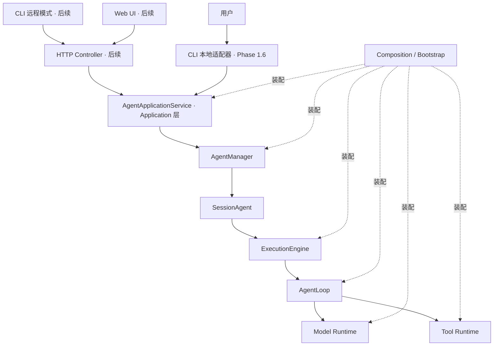
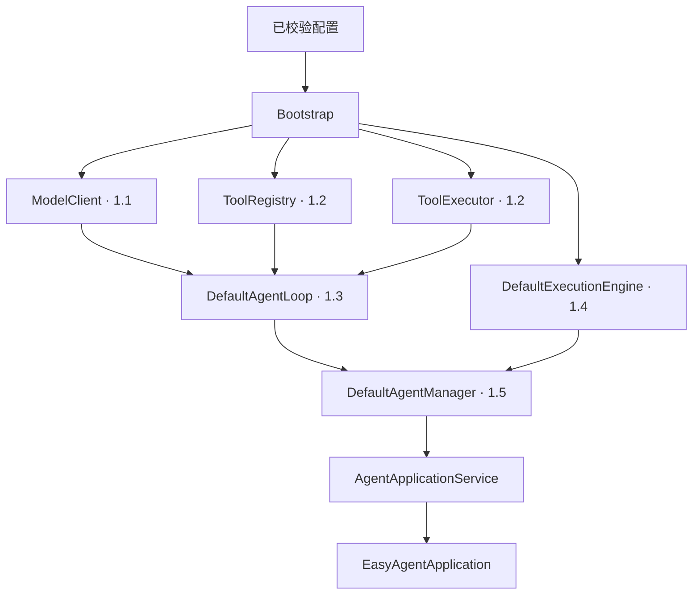

# Easy Agent — Phase 1.6 技术方案与 Coding Agent 开发任务书

> **版本**：V1.0  
> **阶段**：Phase 1.6 — Composition / Bootstrap + Unified Application Service + Local CLI + End-to-End Integration  
> **状态**：2026-11-24 已完成 Phase 1.6-A～E；五项工程检查通过，254 项测试通过、0 失败、0 跳过  
> **日期**：2026-11-24  
> **前提**：Phase 1.1～1.5 已完成。开发前必须核对仓库中真实的公开类型、构造函数、模块导出、测试命令和目录布局；本文中的新增接口为本阶段建议落实的契约，示例类型引用以实际仓库定义为准。**不得为了套用示例而擅自改动 Phase 1.1～1.5 已确认的公共契约。** 如有重大冲突，先列出差异和最小适配方案。

---

## 1. 目标、非目标与验收口径

### 1.1 产品目标

将 Model System（1.1）、Tool Runtime（1.2）、Agent Loop（1.3）、Execution Engine（1.4）、Agent Management（1.5）装配为第一个真实可运行的 Easy Agent，支持：

1. 从命令行启动 `easy-agent chat`，进入本地交互模式。
2. 通过配置选择 OpenAI-compatible 模型及参数，安全读取 Provider 连接信息。
3. 支持多轮会话和实时文本输出。
4. 支持模型 → 工具 → 模型完整调用链。
5. 支持主动取消当前 Execution、切换至新 Session、正常退出并释放资源。
6. 使用 Mock ModelClient 完成**完全离线**的端到端集成测试。
7. **CLI 本地入口和未来 HTTP API 共用 `AgentApplicationService`，而不是互相调用。**

### 1.2 本阶段交付物

- Application 层的统一应用服务契约及默认轻量实现。
- Composition / Bootstrap：配置解析校验、组件装配、启动失败回滚和 `dispose()`。
- 可执行的本地 CLI `easy-agent chat`、`--help`、`--version`，交互命令 `/new`、`/exit`。
- 真实依赖装配集成、Mock ModelClient 离线测试、可选的真实模型冒烟测试。
- 各受影响模块 `README.md`、`changes.md`、相应项目文档及验收报告。

### 1.3 明确非目标

本阶段**不实现**：HTTP Server / REST / SSE、Web UI、SDK、CLI 远程模式、Session Event Log 文件读写、Transaction Journal、Session Write Coordinator、Inbox、Steer、Pause/Resume、Approval、Recovery、Session Tree、Memory 自动抽取、网络 Sandbox、复杂工具权限审批、动态热插拔管理中心。

不得因为应用入口已抽象出来，就提前建设 HTTP 特有的认证、路由、中间件、WebSocket 或网络协议数据模型。

---

## 2. 已确认的顶层架构原则

1. **Harness 提供契约；Runtime、Execution、Agent 等模块分别实现所需契约。** Harness 是横向的规范/扩展/支撑体系，而不是每次执行的纵向必经服务层。
2. **Application 是用户入口层。** CLI、HTTP Controller、SDK 等只做协议与交互适配；共享应用操作应通过统一的 `AgentApplicationService`。
3. **Composition / Bootstrap 是组件装配和生命周期入口，不是新增业务层。** 不能重新实现 Session 调度、Loop 循环或工具执行。
4. **CLI 本地模式直连服务对象，不依赖 HTTP Server。** 未来远程 CLI 由 HTTP Client 调用服务器端 HTTP API，服务器端再调用同一个 Application Service。
5. 默认组件优先复用 Phase 1.1～1.5 现有实现。自定义 Loop/Model/Tool 仍应可以通过既有契约替换；避免把默认组件硬编码进业务层。
6. 当前 Session 与 Execution 只在进程内维护。退出后不能承诺恢复，不能假装有持久化。

### 2.1 分层关系



### 2.2 共用交互入口的准确含义

- **共用应用服务，不共用传输协议。** Service 无 Node `readline`、Express/Fastify Request、HTTP Status、SSE 等依赖。
- CLI 负责终端输入输出、快捷命令与信号处理；HTTP（后续）负责参数解析、鉴权、REST/SSE 映射。
- Session/Execution 业务逻辑只通过 AgentManager、SessionAgent 等实现一次；Service 只委托、验证应用级入参并映射错误。
- 不将 `AgentApplicationService` 误做独立进程、网络微服务或新业务层。
- HTTP 断线不自动代表 Execution 取消：未来传输订阅与运行生命周期仍须分离。

---

## 3. 新增核心公共接口

> 下列代码表达 Phase 1.6 目标契约。`CreateSessionOptions`、`SessionSummary`、`SessionSubmitOptions`、`SessionExecution`、`ExecutionResult` 等**复用 Phase 1.5 / 1.4 已定义的类型**，不另起一套相似类型。`SessionInfo` 如仓库已有等价类型则优先复用；如果没有，只需定义最小只读信息对象。

### 3.1 Application Service

```typescript
export interface SessionInfo {
  sessionId: string;
}

export interface AgentApplicationService {
  createSession(options?: CreateSessionOptions): SessionInfo;
  listSessions(): SessionSummary[];
  deleteSession(sessionId: string): Promise<boolean>;

  submit(
    sessionId: string,
    input: string,
    options?: SessionSubmitOptions,
  ): SessionExecution;

  cancel(sessionId: string, executionId: string): boolean;
}
```

**实现要求**：

- `DefaultAgentApplicationService`（名称可按仓库规范调整）只依赖 `AgentManager` 和已有 `SessionAgent` 公共能力，禁止依赖 ModelClient/ToolExecutor/DefaultAgentLoop 的实现细节。
- `createSession` 委托 `AgentManager.createSession`；仅返回身份信息，不泄露可变 SessionAgent 实例给外部传输适配器。
- `submit` 使用 `getSession(sessionId)`，将输入和覆盖配置委托给 `SessionAgent.submit`，原样返回 `SessionExecution`，**不替代 Agent Layer 实现 FIFO**。
- `cancel` 只对所属 Session 内相应 Execution 发起取消，不能跨 Session 误取消；有效性检查应遵循现有 Phase 1.5 契约。
- `deleteSession` 沿用 Phase 1.5 忙碌时拒绝删除的规则。
- 未找到 Session、无效输入等错误应提供清晰、稳定的应用层错误；不要将其与模型失败、工具失败混为一类。是否使用已有项目统一错误体系，以仓库现状为准。
- 不在 Application Service 中保存重复的上下文/队列/Execution 状态；SessionAgent 和 ExecutionEngine 仍是职责主体。

### 3.2 SessionExecution 与统一事件接口

继续复用 Phase 1.5 的真实契约，概念上为：

```typescript
interface SessionExecution {
  executionId: string;
  events: AsyncIterable<ExecutionEvent>;
  result: Promise<ExecutionResult>;
}
```

**语义不变**：`submit()` 立即进入 Session 队列；运行由 Agent Layer 内部驱动，不依赖 CLI 或未来 HTTP 是否消费 `events`；`result` 独立提供最终结果。事件观察者中断/断线**不应自动取消**业务 Execution。事件缓存有界，溢出时只影响观察，不使任务停止；具体错误信号沿用 Phase 1.5 已有实现。

`AgentApplicationService` 只负责透传，不自行建立第二套事件缓存，也不承担日志持久化。

### 3.3 Bootstrap 入口与应用生命周期

```typescript
export interface EasyAgentApplication {
  readonly service: AgentApplicationService;
  dispose(): Promise<void>;
}

export async function bootstrap(
  config: EasyAgentConfig,
): Promise<EasyAgentApplication>;
```

- `bootstrap` 接收**已解析、已校验的有效配置**。读取文件、环境变量和 CLI 选项可由独立 `loadConfig`/`resolveConfig` 负责。
- 如已有配置系统或 Factory/Dependency Injection 约定，采用现有方式对接，不新增大型 DI 框架。
- `dispose()` 必须可重复调用，重复调用不重复释放或抛出无意义错误；按依赖的逆序释放可释放资源。
- 初始化中途失败，释放此前已成功初始化且由 Bootstrap 拥有的资源，原始错误可追溯。
- 外部注入的共享依赖由谁拥有、谁释放必须明确；原则上不释放不属于本 Bootstrap 的资源。
- 当前 `service` 是统一应用能力接口；未来 HTTP Server 可复用同一个 `bootstrap()` 结果，而不是复制 CLI 初始化逻辑。

---

## 4. Composition / Bootstrap 详细设计

### 4.1 组件依赖图



> 此图表达依赖装配关系而非构造函数的强制签名。**以仓库已实现的依赖关系、Factory 和公共类型为准进行适配。** 不得擅自更改 1.1～1.5 接口来匹配示意图。

### 4.2 装配顺序（建议）

1. 验证 `EasyAgentConfig`。
2. 初始化 ModelClient（OpenAI-compatible Adapter），准备连接配置。
3. 初始化 ToolRegistry、注册基础安全工具、初始化 ToolExecutor。
4. 初始化 DefaultAgentLoop（只使用 Phase 1.3 公共协议）。
5. 初始化 DefaultExecutionEngine。
6. 初始化 DefaultAgentManager / SessionAgent 创建依赖。
7. 初始化默认 AgentApplicationService。
8. 返回 `{ service, dispose }`。

如果已完成模块的实际构造依赖与此不同，仅做 Composition 层适配，不跨层硬编码。

### 4.3 依赖注入与可测试性

- 提供一种**可控、简单**的替换方式，使测试可注入 Mock ModelClient 或完整 Mock 组件，不必发真实网络请求。
- 注入位置应位于 Composition 的可测试工厂或测试专用构造参数，避免在 Harness 公共契约中增加 Mock 字段。
- 真实环境默认使用当前已实现的 ModelClient、ToolRegistry、ToolExecutor、DefaultAgentLoop、DefaultExecutionEngine、AgentManager。
- 不引入基于反射、动态容器的复杂插件/注入平台；热插拔管理留后续。

### 4.4 资源与所有权

- 每次 Bootstrap 对它创建的组件拥有生命周期管理责任。
- 同一个应用实例内复用长期组件；不要每个用户输入重新实例化所有 Runtime。
- 各 Session 的上下文与排队状态相互隔离。
- 退出时确保已运行任务正确取消/等待收尾（由现有契约能支持的范围决定），再释放底层资源。
- 不得在未完成收尾时直接声明任务“已取消”或“结果已持久化”。

---

## 5. 配置系统

### 5.1 配置优先级

**CLI 显式选项 > 环境变量 > 配置文件 > 内置默认值**。

采用一个最终的有效配置对象传给 Bootstrap；不同层不再自行读取 `.env`、用户配置或全局进程变量。

### 5.2 建议的最小配置结构

```typescript
export interface EasyAgentConfig {
  model: {
    provider: 'openai-compatible';
    name: string;
    baseUrl?: string;
    apiKey?: string;
    parameters?: ModelParameters;
  };
  agent: {
    maxModelRetries?: number;
  };
  cli?: {
    stream?: boolean;
  };
}
```

上述结构是**应用级配置示意**；Adapter 构造参数及 Session 级配置映射要匹配当前已实现的类型。模型 `maxModelRetries` 为 Phase 1.3 约定的“单次逻辑调用失败后额外重试次数”，不新增 `maxModelCalls`、`maxToolCalls`、`maxIterations`。

示例配置文件（不包含密钥）：

```json
{
  "model": {
    "provider": "openai-compatible",
    "name": "qwen3-32b",
    "baseUrl": "https://example.invalid/v1",
    "parameters": { "temperature": 0.7 }
  },
  "agent": { "maxModelRetries": 2 },
  "cli": { "stream": true }
}
```

### 5.3 安全规则

- API Key 优先通过环境变量提供；示例文档和配置文件不得包含真实凭证。
- 日志、错误栈、CLI 帮助信息不得泄露 API Key、Authorization Header 等敏感值。
- `--model` 是模型选择；`baseUrl`、`apiKey` 是 Provider 连接配置，不应误作为每轮 Loop 的普通上下文信息。
- 校验模型名不能为空、重试次数是非负整数、URL 格式合法（如提供）。
- 不隐式依赖预置真实 API Key；测试不需要联网。
- 不应因无 API Key 就阻止基于显式注入 Mock ModelClient 的离线测试。

### 5.4 配置到实际运行上下文的传递

Bootstrap 初始化 ModelClient，AgentManager / SessionAgent 使用已确认的 Session 默认配置。用户单次提交时保留覆盖机制；DefaultAgentLoop 最终从本次 `AgentLoopContext.config` 读取模型选项及重试配置。

不要让 DefaultAgentLoop、SessionAgent 或 CLI 各自重新解析同一份外部配置，避免优先级冲突。

---

## 6. CLI 本地模式

### 6.1 命令范围

- `easy-agent chat`：启动本地交互式聊天。
- `easy-agent --help`、`easy-agent --version`：输出帮助和版本。
- 交互命令 `/new`：创建新 Session 并切换当前会话。
- 交互命令 `/exit`：退出并触发资源清理。
- 可选的 `--config`、`--model` 等参数需与配置系统一致；禁止为了完整 CLI 表象引入大量无实际功能的空参数。

首期仅实现**本地直连模式**：`CLI -> AgentApplicationService -> AgentManager`，**不启动 HTTP Server**。

### 6.2 交互流程

```mermaid
sequenceDiagram
    participant User as User
    participant CLI as CLI
    participant Service as AgentApplicationService
    participant Agent as SessionAgent
    participant Engine as ExecutionEngine
    participant Loop as AgentLoop

    User->>CLI: easy-agent chat
    CLI->>Service: createSession()
    Service-->>CLI: sessionId
    User->>CLI: 输入任务
    CLI->>Service: submit(sessionId, input)
    Service->>Agent: submit(input)
    Agent-->>CLI: SessionExecution(events, result)
    Agent->>Engine: execute(request)
    Engine->>Loop: run(context)
    Loop-->>Engine: loop/model/tool events
    Engine-->>Agent: ExecutionEvent
    Agent-->>CLI: events (异步观察)
    CLI-->>User: output_delta 实时展示
    Engine-->>Agent: ExecutionResult
    Agent-->>CLI: result Promise resolved
    CLI-->>User: 输出最终状态
```

### 6.3 终端显示规则

- 优先根据 `ExecutionEvent(type="loop_event", event.type="output_delta")` 展示正文。
- `model_event.text_delta` 可用于调试或诊断，**不得同时当作正文重复打印**。
- `tool_start` / `tool_result` 可用简洁状态展示，不能把任意工具输出未经处理地当作最终答案。
- `result` 是最终结果的权威来源；若观察流缓冲溢出或错过部分输出，可以依据最终 `loopResult.output` 恢复最终显示，但须避免重复追加已经显示的文本。
- CLI 既消费 `events`，也处理 `result` 的 fulfilled/rejected；两者生命周期分离，不把事件流结束当作成功的充分条件。
- 无效输入、模型连接失败、缺少配置应给出可理解的错误，不能只打印不明堆栈。

示意（按真实类型字段调整）：

```typescript
const execution = service.submit(sessionId, input);
let sawOutput = false;
try {
  for await (const item of execution.events) {
    if (item.type !== 'loop_event') continue;
    if (item.event.type === 'output_delta') {
      process.stdout.write(item.event.content);
      sawOutput = true;
    }
  }
} catch (error) {
  // 观察流错误（如有界缓存溢出）不等于执行失败。
  reportObservationIssue(error);
}
const result = await execution.result;
renderFinalStatus(result, { sawOutput });
```

### 6.4 Ctrl+C 与 `/exit`

- 当前任务运行期间，`Ctrl+C` **显式调用** `service.cancel(sessionId, executionId)`；不得依赖终止订阅来隐式取消。
- 取消请求成功不表示任务立刻进入 CANCELLED；应结合 `result` 获取最终终态。
- `/exit` 在没有活动任务时退出；有活动任务时按既定策略请求取消、完成必要清理后退出，避免悬挂资源。
- 避免多次信号/重复退出触发重复 dispose 或重入报错。
- `/new` 切换至全新 Session；不会让之前的历史自动流入新 Session，也不会删除原 Session（原 Session 当前进程内仍可存在）。

### 6.5 CLI 交互的并发边界

第一版 CLI 可以采用**单次输入等待本次最终结果后再接受下一次用户输入**的简单交互，避免额外的并发提示符管理。但底层 SessionAgent 仍应保留 Phase 1.5 已实现的提交 FIFO 能力，不得在 CLI/Service 层重新实现或破坏该能力。

---

## 7. HTTP/SDK 后续兼容约束（本阶段只定义边界）

### 7.1 本地 CLI

```text
CLI (local) -> AgentApplicationService -> AgentManager -> SessionAgent
```

### 7.2 未来 HTTP API

```text
HTTP Request -> HTTP Controller -> AgentApplicationService -> AgentManager
                                   |
                              REST / SSE 适配
```

### 7.3 未来远程 CLI

```text
CLI (remote) -> HTTP Client -> HTTP Server -> AgentApplicationService
```

- HTTP 的 Session 路由、SSE 事件映射、鉴权、断线和结果查询在 HTTP 阶段设计；不在 1.6 预先固定 URI 或 wire format。
- 后续 HTTP 可接入同一个 `EasyAgentApplication.service` 实例，无须复制 Bootstrap。
- 未来如需连接中断后查询/重放任务，需要另行设计结果查询和持久化，不可声称 Phase 1.6 已具备该能力。

---

## 8. 端到端链路与测试工具

### 8.1 必须贯通的链路

```text
CLI -> AgentApplicationService -> SessionAgent.submit()
    -> Session FIFO -> ExecutionEngine.execute()
    -> DefaultAgentLoop.run()
    -> ModelClient.stream()
    -> ToolExecutor.execute() (模型返回 ToolCall 时)
    -> 回填工具结果 -> ModelClient.stream()
    -> AgentLoopResult -> ExecutionResult
    -> Session 成功提交上下文 -> CLI 展示并继续下一轮
```

### 8.2 工具接入策略

- 首期可注册一个**无外部副作用的简单演示工具**（例如加法计算），只为真实验证模型调用工具闭环。
- 工具注册必须使用 Phase 1.2 的 ToolRegistry / ToolExecutor 及现有 `ToolSpec`，**不修改其并发协议**。
- Phase 1.3 DefaultAgentLoop 在一次模型响应包含多个 ToolCall 时仍**全部串行执行**，不得新增工具并行策略。
- 不将任意命令执行、文件覆盖、敏感信息读取工具默认开放给用户，避免引入尚未设计的审批和沙箱安全能力。

---

## 9. 错误、取消和资源清理

| 场景                     | 应有行为                                                |
| ------------------------ | ------------------------------------------------------- |
| 配置缺失/无效            | 启动失败，清晰错误信息，无泄密                          |
| Bootstrap 初始化中途失败 | 清理由本次 Bootstrap 已创建的资源，不返回半初始化服务   |
| Session ID 无效          | Application Service 给出稳定错误，不误创建新 Session    |
| 执行失败                 | CLI 依据 `ExecutionResult` 展示失败，不伪装成功         |
| 主动取消                 | 通过 Service → SessionAgent → Execution Engine 协作取消 |
| 事件观察流异常           | 不自动将 Execution 标记失败；仍获取最终 `result`        |
| Session 忙碌时删除       | 复用 Phase 1.5 的拒绝删除语义                           |
| 用户退出                 | 请求取消当前活动执行、按现有能力收尾、幂等释放资源      |
| 共享组件并发调用         | Session 隔离和运行状态不得串扰                          |

**禁止**：为了使 CLI 退出更快，直接假定工具副作用已撤销；为了做审计，直接把所有 `text_delta` 写入 JSONL；在 CLI 中手工复制 FIFO 调度或 Loop 事件控制。

---

## 10. Coding Agent 开发任务分解

### Phase 1.6-A — Application Service Contract & Implementation

1. 定义 `AgentApplicationService` 及最小 `SessionInfo`（如尚无等价类型）。
2. 编写默认轻量实现，委托 Phase 1.5 AgentManager / SessionAgent。
3. 处理 Session 不存在、输入无效、删除忙碌 Session、跨 Session 取消等边界。
4. 设计不依赖 CLI/HTTP 的模块测试。
5. 为新模块创建或更新 `README.md`、`changes.md`。

**验收**：无 Model/Tool 依赖；相同服务可供 CLI 与模拟 HTTP 适配调用；不会产生第二套上下文和队列状态。

### Phase 1.6-B — Config & Composition / Bootstrap

1. 配置读取、合并优先级和校验。
2. 初始化 ModelClient、ToolRuntime、AgentLoop、ExecutionEngine、AgentManager、Application Service。
3. 注入式离线测试支持。
4. 资源所有权、失败回滚及幂等 `dispose()`。
5. 保留替换模型与 Agent Loop 的能力，不硬编码到 CLI。

**验收**：配置无效启动失败明确；Mock ModelClient 无网络可启动；正确释放资源；Session 并发隔离。

### Phase 1.6-C — Local CLI

1. `easy-agent chat`、`--help`、`--version`。
2. `/new`、`/exit` 及终端交互循环。
3. 通过 `service` 创建 Session 和提交输入，实时展示 `output_delta`。
4. 处理 `result` 成功、失败、取消与观察流异常。
5. `Ctrl+C` 显式取消 Execution，正常关闭时完成清理。

**验收**：CLI 代码不直接创建或调用 ModelClient、ToolExecutor、DefaultAgentLoop、ExecutionEngine 等底层对象；仅从 Bootstrap 获取 Service。

### Phase 1.6-D — End-to-End Integration

1. 用 Mock ModelClient 测试单轮模型回复。
2. 用 Mock ModelClient + ToolRuntime 测试 model → tool → model。
3. 测试同一 Session 多轮上下文继承、不同 Session 隔离。
4. 验证取消、失败路径、工具错误回填、重复输出防护。
5. 可选用真实模型凭据进行手动冒烟测试，但不得作为离线验收的前置条件。

**验收**：上述功能在仓库现有标准测试命令下通过，完全离线可复现。

### Phase 1.6-E — Docs & Acceptance

1. 更新架构图、模块 README、changes.md、项目阶段计划/索引。
2. 对每次实质性变更记录日期、变更前后、原因、影响范围、相关决策及验证结果；保留时间线。
3. TypeScript typecheck、Lint、Format、Build、Test 全部通过。
4. 提供执行命令、配置示例、启动示例、测试报告。
5. 完成后**停止，不自动进入后续 HTTP/Persistence 阶段**。

---

## 11. 必须通过的验收矩阵

| ID    | 验收情景                                    | 预期结果                                          |
| ----- | ------------------------------------------- | ------------------------------------------------- |
| AC-01 | Bootstrap 默认配置/有效配置                 | 装配成功，暴露 `service` 与 `dispose`             |
| AC-02 | 缺模型名、非法重试次数或错误 URL            | 校验失败，错误清晰，无敏感字段泄漏                |
| AC-03 | CLI 参数、环境、配置文件同时提供同项配置    | 按约定优先级解析                                  |
| AC-04 | Service 创建/查询列表/删除 Session          | 委托 Manager，遵守 Phase 1.5 规则                 |
| AC-05 | Service 提交两次输入                        | 同 Session FIFO，第二次读到第一次成功提交的上下文 |
| AC-06 | 同时创建两个 Session                        | 上下文、任务、取消相互隔离                        |
| AC-07 | Mock Model 一次回复                         | CLI 实时展示，获得 COMPLETED 和最终结果           |
| AC-08 | Mock Model 返回 ToolCall，ToolExecutor 执行 | 模型→工具→模型全流程正确                          |
| AC-09 | 多工具 ToolCall                             | 依次串行执行，按调用 ID 回填，不改 1.2            |
| AC-10 | 事件同时带 model_event 与 output_delta      | 用户正文不重复展示                                |
| AC-11 | 事件观察流提前退出或溢出                    | 任务仍可完成，`result` 可用                       |
| AC-12 | Ctrl+C                                      | 调用 Service 取消，按最终结果显示状态             |
| AC-13 | 模型/工具执行失败                           | CLI 明确输出错误，资源清理正确                    |
| AC-14 | `/new`                                      | 新 Session 不带旧历史；旧 Session 不被意外删除    |
| AC-15 | `/exit` 和重复 dispose                      | 无未处理 Promise rejection，释放幂等              |
| AC-16 | 初始化中途报错                              | 已拥有资源得到回滚释放                            |
| AC-17 | 无网络、无真实 API Key                      | 端到端 Mock 测试全通过                            |
| AC-18 | 非 CLI 调用同一个 Service（测试适配器）     | 不依赖 CLI/HTTP 细节，可直接调用                  |

---

## 12. 文档和变更记录规范

本项目已确定：**每个逻辑模块（以独立职责包/模块为粒度，而非每个源文件）维护 `README.md` 和 `changes.md`**。

- `README.md` 描述当前实际实现、功能边界、公共接口、依赖、使用示例及限制。
- `changes.md` 记录各次实质性调整的时间线：日期、旧设计、新设计、变更原因、影响范围、兼容策略与验证记录。
- 架构级调整同步更新 `docs/architecture.md` 和 `docs/changes.md` 等现有文档。
- 新增 Application Service 和 Bootstrap 后，要解释二者区别：Service 是应用操作门面，Bootstrap 是装配/资源生命周期，不是新的业务执行层。
- 如果实施细节与本文件不同，但不影响公共契约、行为和验收，可在模块文档记录；如需更改已确认方案或现有公共契约，应先向用户报告差异。

---

## 13. 开发前必须核对的事项（不是新的设计讨论）

Coding Agent 应在修改代码前，检查：

1. Phase 1.1～1.5 的真实导出路径、对象构造方式、现有 Factory/依赖注入习惯。
2. AgentManager 的 `createSession/getSession/listSessions/deleteSession` 真实签名。
3. SessionAgent `submit/cancel/getContext` 的真实签名和排队语义。
4. `SessionExecution` 事件缓冲溢出行为、`result` 的 Promise 生命周期。
5. Phase 1.4 ExecutionEvent 和 ExecutionResult 的实际类型；Phase 1.3 输出事件的字段名称。
6. ModelClient Adapter 的连接配置、工具装配机制以及 CLI 入口脚本的工程约定。

对于不影响本阶段目标的实现差异，在 Composition 层适配；对于重大冲突，先报告而非擅自重写上游模块。

---

## 14. 明确废弃或不在本阶段采用的方案

- ❌ CLI 本地模式统一经 HTTP Server 才能交互。
- ❌ CLI、HTTP 各自实现一套 Session/Execution 调度和上下文逻辑。
- ❌ CLI 直接实例化全部 Model/Tool/Loop/Engine 依赖。
- ❌ Application Service 变成独立业务层或重复存储 Session 状态。
- ❌ `submit()` 等待观察者消费 events 才启动执行。
- ❌ 观察者退出或 HTTP 连接断开就默认取消 Execution。
- ❌ 为 Phase 1.6 新增 Agent Loop 最大模型调用次数、工具调用次数或迭代次数上限。
- ❌ 多 ToolCall 并行执行；本阶段保持 Phase 1.3 的**串行**策略。
- ❌ 提前实现 Session Event Log、HTTP Server 或完整扩展插件平台。

---

## 15. Coding Agent 启动指令（可直接复制）

> 现在开始 Easy Agent Phase 1.6：Composition / Bootstrap + 统一 Application Service + 本地 CLI + 端到端集成。
>
> 请先阅读根目录 `AGENTS.md`、项目架构/规范文档，以及 Application、Agent、Execution、Harness、Runtime 等相关模块的 `README.md`、`changes.md`。
>
> 本阶段以 `docs/phase-1.6.md` 为**唯一阶段级开发依据**。必须复用 Phase 1.1～1.5 已实现的契约，先核查实际导出与构造签名，再进行适配和开发。
>
> 请按 1.6-A → 1.6-B → 1.6-C → 1.6-D → 1.6-E 顺序完成：
>
> 1. 实现统一 `AgentApplicationService`，使 CLI 本地模式和未来 HTTP API 复用同一套 Agent 操作；Service 不依赖终端或 HTTP 协议。
> 2. 实现 Composition / Bootstrap 和配置解析/校验、依赖装配、启动失败回滚与幂等 `dispose()`。
> 3. 实现 `easy-agent chat` 本地交互、多轮对话、`/new`、`/exit`、流式输出及 Ctrl+C 取消。
> 4. 复用 Phase 1.5 的 `SessionExecution.events` + `result` 分离语义；观察者取消不等于任务取消。
> 5. 用 Mock ModelClient 完成纯离线端到端测试，覆盖模型→工具→模型、Session 隔离、异常与资源清理。
> 6. 不实现 HTTP Server、Session Event Log、Inbox、Recovery 等后续能力；不新增 Loop 次数上限或 Tool 并行策略。
> 7. 按模块维护 `README.md` 和 `changes.md`，记录原因和时间线；所有 Typecheck/Lint/Format/Build/Test 必须通过。
>
> 如遇重大公共契约冲突，请先汇报具体差异和最小解决方案，不擅自改写 Phase 1.1～1.5。
>
> 最后输出：修改文件清单、已完成能力、实际执行命令、测试结果、剩余限制、设计偏差及变更记录；**完成 Phase 1.6 后停止，不自动开发 HTTP/Persistence。**

---

## 16. 阶段结束定义（Definition of Done）

满足以下条件，Phase 1.6 才算完成：

- 从仓库提供的 CLI 启动方式可进入本地 `easy-agent chat`。
- CLI 通过**统一 Application Service** 而非直接调度底层 Runtime。
- 可完成真实的 Session 创建、单轮/多轮对话、流式输出和取消。
- 模型→工具→模型链路在离线集成测试中跑通；多个工具仍串行。
- 装配过程清晰，可配置、可测试、可释放；Mock 测试不依赖密钥及网络。
- 运行和观察流的生命周期分离，未破坏 Phase 1.5 已确认语义。
- 变更及模块文档齐全，工程检查全部通过。
- 没有越界实施 HTTP Server、Session Event Log 或其他后续阶段能力。

## 17. 实际交付与验收记录

### 17.1 实际入口及实施取舍

真实使用入口、配置和示例见 [项目 README](../README.md#本地-cli)、[Application](../src/application/README.md)、[Composition](../src/composition/README.md) 与 [CLI](../src/application/cli/README.md)。仓库源码启动命令为 `npm run chat -- --model <name>`，构建入口为 `node dist/application/cli/bin.js chat --model <name>`，包的 bin 名称为 `easy-agent`。本阶段未把 `npm link` 作为前置条件或已验证安装方式。

- 统一 `AgentApplicationService` 位于 Application，复用 Harness 的 Manager/Session/Execution 类型；只委托应用操作，不维护第二份上下文、FIFO 或观察缓存。
- `loadConfig` 在初始化边界读取环境和显式 JSON，`resolveConfig` 纯合并；不自动查找文件或加载 `.env`。优先级保持 CLI > 环境 > 文件 > 默认值。模型名必填且无内置真实模型；默认 provider 为 openai-compatible、额外重试 2、流式输出 true。新增 `logging.level` 在同一边界解析后显式注入 Logger，不改变独立 Logging 的既有接口。
- Bootstrap 只暴露 service/dispose。共享注入由调用方拥有；自有模型工厂返回 `{client, dispose?}`，其成功移交的资源在回滚/退出时释放一次。应用只登记经自己 Service 提交的未结算句柄用于关闭，不接管外部共享 Manager 的其他任务。
- 旧组件没有统一 dispose 协议，不猜测或改写其公共接口。启动和释放异常以固定分类、失败阶段及清理标记追溯，不透传可能含密钥的第三方原始异常；这是本阶段安全错误边界的具体落实。
- CLI 按 §6.5 每轮等待最终结果再处理下一行；输入流中排在任务之后的 `/exit` 在该轮收尾后处理，Ctrl+C 始终可以即时显式请求取消。只渲染 output_delta，按最后一轮模型预览与权威最终结果比较；不一致时明确显示替换区块，不能撤回已经写入终端或管道的预览字节。
- 默认 `add({a,b})` 为无外部副作用的纯计算工具。多个 ToolCall 继续通过真实 ToolExecutor 和既有 DefaultAgentLoop 串行执行，不增加循环总次数上限或新的执行策略。

### 17.2 AC-01～AC-18 证据索引

AC-01～AC-18 均已由下表关联的实际离线测试覆盖并通过；完整工程命令和测试构成见 §17.3。

| 验收  | 实际证据                                                                                   | 测试文件                                                                                                                                                 |
| ----- | ------------------------------------------------------------------------------------------ | -------------------------------------------------------------------------------------------------------------------------------------------------------- |
| AC-01 | 合法模型配置与内置默认值完成装配，暴露 service/dispose                                     | [bootstrap.test.ts](../tests/bootstrap.test.ts)                                                                                                          |
| AC-02 | 缺模型、非法重试/URL 等安全拒绝，错误不回显密钥和原始配置                                  | [composition-config.test.ts](../tests/composition-config.test.ts)                                                                                        |
| AC-03 | CLI 显式项 > 环境 > 文件 > 默认值，参数按键合并                                            | [composition-config.test.ts](../tests/composition-config.test.ts)、[cli.test.ts](../tests/cli.test.ts)                                                   |
| AC-04 | 创建身份、列表、忙碌删除 false、空闲删除与缺失 Session 稳定错误                            | [agent-application-service.test.ts](../tests/agent-application-service.test.ts)                                                                          |
| AC-05 | 无事件观察者也执行；同 Session 连续输入 FIFO、继承成功历史                                 | [agent-application-service.test.ts](../tests/agent-application-service.test.ts)、[phase-1.6-integration.test.ts](../tests/phase-1.6-integration.test.ts) |
| AC-06 | 真实装配下跨 Session 并发，历史和取消相互隔离                                              | [phase-1.6-integration.test.ts](../tests/phase-1.6-integration.test.ts)                                                                                  |
| AC-07 | CLI 在模型结束前已展示增量，最终 COMPLETED                                                 | [phase-1.6-integration.test.ts](../tests/phase-1.6-integration.test.ts)                                                                                  |
| AC-08 | Mock Model → 真实默认 add 工具 → Mock Model，调用 ID/上下文完整                            | [phase-1.6-integration.test.ts](../tests/phase-1.6-integration.test.ts)                                                                                  |
| AC-09 | 两个 ToolCall 由真实 Runtime 串行处理，按 ID 和顺序回填                                    | [phase-1.6-integration.test.ts](../tests/phase-1.6-integration.test.ts)                                                                                  |
| AC-10 | model_event 与 output_delta 同时出现时正文只打印一次；多次模型往返不重复最终答案           | [cli.test.ts](../tests/cli.test.ts)、[phase-1.6-integration.test.ts](../tests/phase-1.6-integration.test.ts)                                             |
| AC-11 | 观察提前退出或缓冲溢出不取消执行，独立 result 与上下文提交继续                             | [phase-1.6-integration.test.ts](../tests/phase-1.6-integration.test.ts)、[cli.test.ts](../tests/cli.test.ts)                                             |
| AC-12 | Ctrl+C 经 Service 显式取消，重复信号去重，等待模型清理并显示真实 CANCELLED                 | [cli.test.ts](../tests/cli.test.ts)、[phase-1.6-integration.test.ts](../tests/phase-1.6-integration.test.ts)                                             |
| AC-13 | 模型失败显示 FAILED 且不提交部分历史；工具业务错误安全回填，模型可继续；释放不泄露原始错误 | [phase-1.6-integration.test.ts](../tests/phase-1.6-integration.test.ts)、[bootstrap.test.ts](../tests/bootstrap.test.ts)                                 |
| AC-14 | /new 产生空历史 Session，保留旧 Session，后续输入不串历史                                  | [cli.test.ts](../tests/cli.test.ts)、[phase-1.6-integration.test.ts](../tests/phase-1.6-integration.test.ts)                                             |
| AC-15 | /exit、EOF、重复/重入 dispose 等待收尾，资源只释放一次，移除监听                           | [cli.test.ts](../tests/cli.test.ts)、[bootstrap.test.ts](../tests/bootstrap.test.ts)                                                                     |
| AC-16 | 初始化中途失败回滚自有模型，不释放外部共享资源，错误固定安全分类                           | [bootstrap.test.ts](../tests/bootstrap.test.ts)                                                                                                          |
| AC-17 | 所有模型行为均由注入 Mock 提供，真实 Loop/Engine/Agent/Tool 参与，不依赖网络或 API Key     | [phase-1.6-integration.test.ts](../tests/phase-1.6-integration.test.ts)、[bootstrap.test.ts](../tests/bootstrap.test.ts)                                 |
| AC-18 | 模拟非 CLI 适配器直接共享同一 Service，句柄透传、无终端/HTTP 依赖                          | [agent-application-service.test.ts](../tests/agent-application-service.test.ts)                                                                          |

源码/构建 ESM 导入以及编译后 CLI 的帮助、版本和导入无副作用另由 [smoke.test.ts](../tests/smoke.test.ts) 验证。上述 Mock 是离线依赖替身，不能解读为真实 Provider 或模型 API 的烟测结果。

### 17.3 工程验收记录

2026-11-24，在仓库根目录实际执行以下命令，均退出码 0：

| 命令                   | 实际结果                   |
| ---------------------- | -------------------------- |
| `npm run typecheck`    | 通过                       |
| `npm run lint`         | 通过，0 警告               |
| `npm run format:check` | 通过                       |
| `npm run build`        | 通过                       |
| `npm test`             | 254 项通过，0 失败、0 跳过 |

254 项由既有 216 项与本阶段新增 38 项组成：Service 7、配置 3、Bootstrap 6、CLI 12、完整端到端 9、编译后 CLI smoke 1。测试使用注入式 Fake/Mock 与真实既有 Loop/Engine/Agent/Tool 的离线组合，不依赖网络、外部服务或真实 API Key。

另外实际运行 `npm run chat -- --help`，以及构建后 bin 的帮助、版本、无副作用 ESM 导入。未执行 `npm link`，未用真实 Provider/API 凭据烟测。差异检查确认 `src/harness`、`src/agent`、`src/execution`、`src/runtime` 下既有 TypeScript 契约及实现均未修改；本阶段仅通过 Application/Composition 适配和复用。

模块 README 与 changes.md 已同步，跨模块决定见 [项目变更记录](changes.md)。Phase 1.5 的 216 项及此前 146/147/151/187 等历史验收保留，均未替换为本阶段数据。

### 17.4 边界与停止点

本阶段没有真实 Provider/API 烟测，也没有执行本地 `npm link` 安装验收。取消和资源清理沿用协作机制，不新增强制结束、隐式超时或副作用回滚承诺；当前 Session/上下文仍只在内存中。外部通过共享 Manager 绕过本应用 Service 提交的任务及共享资源，由外部调用方负责。

不实现 HTTP Server、SSE、远程 CLI、正式 SDK、Session Event Log、持久化 Inbox、Recovery、Workspace、复杂 DI 或工具并行；**Phase 1.6-A～E 已完成并停止；未自动开发后续 HTTP/Persistence。**
