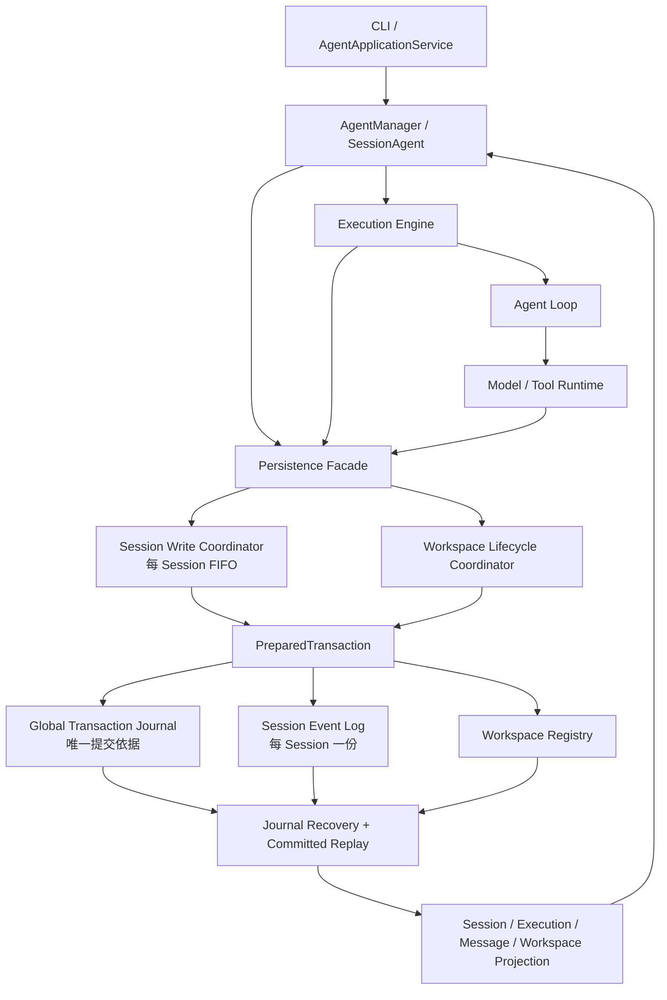
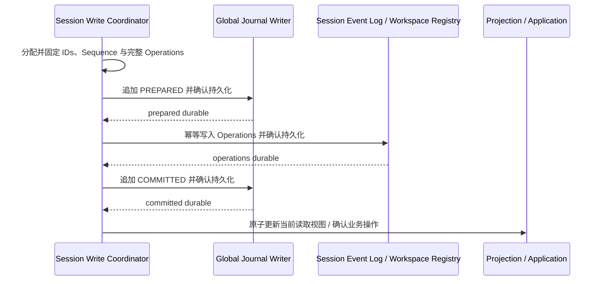
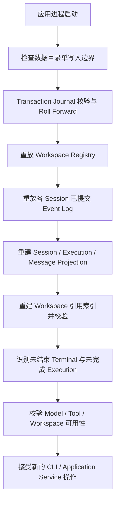

# Easy Agent — Phase 2.4：Persistence、Session Event Log 与冷启动状态重建

> **状态**：本机（darwin）实现与离线验收已完成；十项核心设计决策已落地。Windows / Linux 原生持久化验收未在本机执行。  
> **日期**：2026-11-26  
> **仓库目标路径**：`docs/phase-2.4.md`  
> **前置基线**：Phase 1、Phase 2.1、Phase 2.2 已由项目负责人确认完成；**Phase 2.3（HTTP API / SSE）已明确暂缓**，本阶段不依赖 HTTP。  
> **实现入口**：`src/runtime/persistence/`；配置 `persistence.dataDir`；Bootstrap 冷启动恢复。

## 1. 阶段目标

在 TypeScript / Node.js 单 Runtime 进程和本地文件存储的既定路线下，补全会话、执行、交互事实及 Workspace 注册信息的可靠持久化，使 Easy Agent 能够：

1. 进程退出并重新启动后，恢复已有 Session 的模型、工具选择、Workspace 关联及**已成功提交**的模型可见历史，继续通过 CLI 对话。
2. 查询已完成、失败、取消及中断的历史 Execution，保留真实的 LLM、Tool、Approval 等关键事实。
3. 将 Runtime 全局 **Transaction Journal**、Session 级 **Write Coordinator** 与追加式 **Session Event Log** 组织成可确认提交、可幂等恢复的本地事务机制。
4. 通过 Event Replay 重建 Session、Execution、Message Projection，不预先引入 Snapshot。
5. 持久化 Workspace 注册信息、已知 `UNSAFE` 状态和 Terminal 活动记录，避免异常退出后不当放行 Workspace。
6. 对持久化故障实行 **fail closed / 严格持久化**：未可靠提交关键事实，不执行依赖该事实的后续操作，也不对外声称持久化成功。

**不实现**：崩溃后自动继续 Agent Loop、重试 LLM/Tool、自动恢复排队任务、HTTP API/SSE、持久化 Follow-up/Inbox/Steer、完整跨进程 Execution Recovery、Snapshot、数据库/Redis、多进程共享写入。

最高设计原则保持不变：**Harness 定义协作契约，Runtime / Agent / Execution 按职责实现和使用；Composition / Bootstrap 负责装配。** 不将持久化细节侵入 Agent Loop 的策略逻辑，不为存储功能重新设计模型/工具执行链。

## 2. 十项已确认设计决策（不可擅自更改）

| #   | 主题                   | 已确认决策                                                                                                                                          |
| --- | ---------------------- | --------------------------------------------------------------------------------------------------------------------------------------------------- |
| 1   | Projection 构建        | 启动时重放已提交的 Session Event Log；**暂不实现 Snapshot**。                                                                                       |
| 2   | 事务粒度               | **按关键交互阶段分批提交事务**；一事务可以包含多个必须原子生效的事件/操作，不把整个 Execution 包在长事务内。                                        |
| 3   | 事务恢复               | 采用 **Roll Forward**：仅恢复完整有效 `PREPARED` 固化的本地持久化 Operations；幂等补写并 `COMMITTED`；**不重新执行 LLM 或 Tool**。                  |
| 4   | 提交依据               | **Runtime 全局 Transaction Journal 是唯一事务提交依据**；Session Event Log 不额外记录 `transaction/committed`。                                     |
| 5   | Message Projection     | Event Log 保留所有已提交关键交互事实；**默认只有成功完成且正式提交历史的 Execution 进入后续模型对话历史**，延续 Phase 1 行为。                      |
| 6   | Workspace 归属         | Workspace 通过**独立 Registry** 持久化、复用全局 Journal；Session 只存稳定 `workspaceId` 引用。                                                     |
| 7   | Workspace 安全         | 持久化 `UNSAFE` 状态及 `terminal_intent` / `terminal_settled` 等活动事实；冷启动发现未结束 Terminal 活动，Workspace 进入 `UNSAFE`，需人工确认恢复。 |
| 8   | Session–Workspace 引用 | 通过 Workspace **生命周期协调**保证 Session 创建与 Workspace 删除不竞态；各自独立事务；引用索引从已提交 Session 历史重建，不单独持久化。            |
| 9   | 未完成 Execution       | 冷启动时原 `RUNNING`、`QUEUED`、等待 Approval 的 Execution **均识别为中断**；不自动运行、重新入队或接受旧 Approval 的迟到决策。                     |
| 10  | 存储故障               | **严格持久化**：关键事务未确认可靠提交时，停止相关执行；不能自动重复可能产生副作用的 LLM/Tool；事务结果不确定则先恢复/核查。                        |

这些决策优先于较早的 Phase 2 规划草案。若代码实现暴露与已确认决策的实质冲突，**先向项目负责人确认变更**，不得擅自回退到旧方案或将后续阶段提前开发。

## 3. 系统架构、数据流与责任边界



| 组件                                        | 负责                                                                                                       | 不负责                                 |
| ------------------------------------------- | ---------------------------------------------------------------------------------------------------------- | -------------------------------------- |
| Persistence Facade / Application 集成       | 为 Session / Execution / Approval / Tool / Workspace 提供语义化持久化入口；提交结果与错误显式传递          | 根据失败猜测 Tool 是否已经执行         |
| PreparedTransaction                         | 冻结 Transaction/Operation/Event ID、目标文件、完整记录内容、Session Sequence/Workspace 顺序标识和校验信息 | 执行 LLM / Terminal / 文件工具副作用   |
| Runtime Global Transaction Journal          | 序列化全局 Journal 追加；存 `PREPARED` / `COMMITTED`；恢复待完成事务                                       | 保存全部对外业务 Projection            |
| Session Write Coordinator                   | Runtime 级 Manager + Session 级 FIFO 写入队列；分配/保留 Session Sequence；禁止同 Session 事务交错         | 直接管理其他 Session 的模型执行调度    |
| Session Event Log                           | 每 Session 独立追加事实事件                                                                                | 自行判定事务提交；重复维护 commit 标记 |
| Workspace Registry / Lifecycle Coordination | 持久化 Workspace 注册、安全及 Terminal 活动事实；协调引用一致性                                            | 代替 Phase 2.2 的 Workspace 文件访问锁 |
| Replay / Projection                         | 只读取通过 Journal 确认提交的记录；重建当前读取视图；识别中断执行                                          | 再次调用 LLM / Tool；重放对外副作用    |
| Composition / Bootstrap                     | 启动时恢复 Journal，重放 Registry/Event Log，再恢复应用对象与接受新操作                                    | 让 CLI/HTTP Controller 各自实现存储    |

Session Write Coordinator、Workspace Lifecycle Coordinator、WorkspaceAccessCoordinator（Phase 2.2 文件读写锁）是**不同的协调范围**；切勿互相替代或交叉调用形成无穷等待。

## 4. 存储组织与文件格式

以下为**推荐布局**，实现时可按仓库规范调整名字，但必须保持全局 Journal、Session 日志和 Workspace Registry 的职责边界：

```text
data/
├── journal/
│   └── transactions.jsonl             # 全局事务日志，唯一提交依据
├── sessions/
│   ├── <session-id>/
│   │   └── events.jsonl               # 仅业务事件
│   └── <another-session-id>/
│       └── events.jsonl
└── workspaces/
    └── registry.jsonl                 # Workspace 资源/安全/Terminal 活动事实
```

### 4.1 Event Envelope（逻辑示意）

```typescript
interface SessionEventEnvelope {
  id: string;
  sessionId: string;
  executionId?: string;
  sequence: number; // 同一 Session 中按已确认事务顺序分配
  transactionId: string;
  type: string;
  payload: unknown;
  timestamp: string;
  schemaVersion: number;
}
```

**必要约束**：Session Sequence 在构造 PREPARED 时分配并固定；同一事务多个 Session Event 使用连续 Sequence。`PREPARED` 必须含有可恢复的**完整、不可变**操作内容，不能只含一组引用而需要向已丢失的进程内存追问。Workspace Registry 的顺序/幂等标识独立管理，**不能借用某个 Session 的 Sequence**。

### 4.2 Transaction Journal（逻辑示意）

```jsonl
{"transactionId":"tx-001","state":"PREPARED","schemaVersion":1,"operations":[{"operationId":"op-001","target":"sessions/session-001/events.jsonl","record":{"id":"evt-010","sessionId":"session-001","sequence":10,"transactionId":"tx-001","type":"user/message","payload":{"content":"分析项目"},"timestamp":"...","schemaVersion":1}}]}
{"transactionId":"tx-001","state":"COMMITTED","schemaVersion":1}
```

此处的字段是结构示意。实际需要明确 Record/Operation 的确定性序列化、唯一标识、目标资源标识以及完整性校验（如记录长度/摘要）；`target` 必须是受系统管理的存储资源，**不能从外部请求直接注入任意文件路径**。

**单事务操作范围**：初期以「一个 Session 的 Event Log」或「Workspace Registry 的一组记录」为基础单位；全局 Journal 能承载两类操作，但**不因该能力推导出本阶段要实现跨资源大事务**。需要联动的资源关系由生命周期锁和分阶段提交保障。

### 4.3 文件可靠性约束

- JSONL 每条记录一行；检测**尾部不完整记录**，在确认属于可安全修复尾部时保留诊断、截断到完整记录边界，并按 PREPARED 补写；**中间记录损坏、已提交内容不一致必须停止自动恢复并报告**。
- 不能仅以“JSON 可解析”判断完整：恢复时需核对 ID、Sequence、Transaction、Operation 和内容一致性；同 ID 不同内容必须报错。
- **先可靠持久化 PREPARED → 再持久化 Operations → 最后可靠持久化 COMMITTED → 更新 Projection / 发布提交事件 / 确认业务成功**。未 COMMITTED 的事件不可见。
- 区分 Node.js `write` 返回、文件同步、目录元数据持久化与真实保证；按目标系统和文件系统定义合理的 fsync / 文件句柄 / 新目录创建同步策略。不能仅依据写入缓存成功声称已可靠提交；平台无法提供同等级保证时应明确限制。
- Journal 的追加统一串行协调；不同 Session Event Log 可并发持久化，但各 Session 内的顺序和全局 Journal 的记录完整性必须保持。
- 单进程持有同一数据目录的**唯一写入权**：启动时防止误用相同存储目录的第二个 Runtime 写进程；若无法可靠实施跨平台目录独占，需要至少拒绝已知冲突并在文档中明确单写进程限制，不能宣称多进程安全。
- 敏感凭据、API Key 不能写进 Event Log；Tool/LLM 可能含秘密数据，需明确数据保留、脱敏或访问保护策略，同时**不能静默裁掉 Projection 必需的恢复内容**。

## 5. 事务写入协议、幂等与恢复

### 5.1 正常提交顺序



**具体事务边界示例**：

- Session 创建：`session/created`，提交后才向应用确认创建。
- Execution 提交：用户输入事实与 `execution/created` **同一事务**，包含已冻结的模型/工具等选择（与 Phase 2.1/2.2 实际已实现契约一致）；入队前完成可靠提交。
- Execution 启动：独立提交 `execution/started`。
- LLM 请求：`llm/request` 在真正发起远程调用前提交。
- LLM 完整响应：`llm/response` 在后续调度 Tool Call 前提交。
- Tool Call：`tool/call` 在真正执行（或进入审批）前提交；参数和 Tool Call ID 固定。
- Approval：`approval/requested` 和 `approval/resolved` 按已发生的审批事实分别可靠提交；**批准事实未提交，不得启动工具**；拒绝/超时仍保留对应事实。
- Tool Result：工具结束后提交 `tool/result`；**提交失败时不得继续下一 Agent Step**。
- Execution 终态：最终结果及 `execution/completed`、`execution/failed` 或 `execution/cancelled` 等事实必须原子提交后才报告已可靠完成；已有公共状态名优先沿用。
- Workspace 安全与生命周期：按第 8/9 节规则，在 Workspace Registry 分别提交。

同一事务可以含多条事件，但 **LLM 请求/Tool 操作本身不在持久化事务内**，也不允许 Event Replay 自动重放业务动作。

### 5.2 Roll Forward 规则

1. 启动后**先**读取并校验全局 Journal；识别有效 PREPARED、有无对应有效 COMMITTED，以及记录完整性。
2. 对 PREPARED 已完整持久化但未确认 COMMITTED 的事务，使用**同一** transactionId、operationId、eventId、sequence 和记录内容恢复；不可重新生成并追加另一套标识。
3. 逐项核验已写入的 Operation：完整一致则跳过，缺失则补写，尾部损坏按受约束的修复机制处理；任何冲突则阻断自动恢复。
4. 所有 Operations 可靠落盘后，追加并确认 COMMITTED。COMMITTED 已存在的事务进行相应完整性校验；不能把内容缺失的已提交事务静默视为正常。
5. 恢复完成后建立已提交事务集合，按各流合法顺序重放 Event Log / Workspace Registry，再开放服务和写入入口。
6. 恢复过程中不得执行 LLM、Tool、Terminal 或重新发起 Approval；**Roll Forward 只恢复准备好的存储 Operations**。

**对错误提交结果的处理**：

- `COMMITTED`：确认事务成功，可继续。
- `NOT_PREPARED`：仅在确定 PREPARED **未可靠形成**时使用；若同步失败使其是否落盘不确定，不能贸然认定未准备。
- `COMMIT_UNCERTAIN`：PREPARED 或 COMMITTED 的确认存在不确定性，或部分 Operations 未知；冻结受影响写入，依原事务标识恢复/核查，**不可创建新事务重复提交同一逻辑操作**。

这些是逻辑分类，并非必须新增同名公共枚举；实现应使用与现有异常/错误契约一致的结果类型。

### 5.3 启动顺序



若 Journal、已提交数据或不可恢复的引用关系出现损坏：**不得跳过错误继续以可写模式运行**。可以提供只读诊断/人工修复手段，但不得对未确认的数据声称已恢复。

## 6. Event Schema 与三个 Projection

### 6.1 事件词汇（建议对齐现有契约）

| 类别                  | 示例事件                                                                                                   | 最小必要事实                                                |
| --------------------- | ---------------------------------------------------------------------------------------------------------- | ----------------------------------------------------------- |
| Session               | `session/created`, `session/model_changed`, `session/deleted`                                              | Session ID、工具/模型/扩展/初始上下文、Workspace 引用、删除 |
| Execution             | `execution/created`, `execution/started`, `execution/completed`, `execution/failed`, `execution/cancelled` | ID、归属、输入与冻结配置、状态改变、最终结果/错误           |
| User                  | `user/message`                                                                                             | 用户输入及其所属 Execution                                  |
| LLM                   | `llm/request`, `llm/response`                                                                              | 标准化请求与完整响应；不得逐 token 落盘                     |
| Tool                  | `tool/call`, `tool/result`                                                                                 | toolCallId、参数、结果/错误、关联 Execution                 |
| Approval              | `approval/requested`, `approval/resolved`                                                                  | 一次工具调用对应的请求、决策/拒绝/超时/取消和参数绑定       |
| Context               | `context/summary_committed`                                                                                | 已**正式采用**的摘要及其生效边界                            |
| Recovery 事实（按需） | `execution/interrupted_detected`（示意）                                                                   | 冷启动检测到意外中断的事实，而非伪造正常完成/取消           |

**具体事件名、结构与已有项目事件总线核对**：避免为相同事实引入两套事件名；区分运行时展示事件（含流式 delta）和持久化交互事实（完整响应）。实时 Token / Delta、普通上下文组装、临时预算计算和临时裁剪**不入 Session Event Log**。

### 6.2 Session Projection

从 `session/created`、模型/工具等**正式提交的配置变更事件**重建 Session 当前状态，至少包含 Session ID、模型标识、工具集合、Workspace ID、创建时间。Session 只引用 Workspace ID，**不复制 Workspace 的完整定义**。已创建 Session 不支持任意切换已有 Workspace。

### 6.3 Execution Projection

从创建、启动、终态等已提交事件还原 Execution ID、所属 Session、固定模型/工具/输入、最后可靠状态、结果和错误；对缺少正常终态者按第 10 节识别中断。**提交时模型和工具选择固定**，不因为启动后 Session 配置变化而追溯修改历史 Execution。

### 6.4 Message Projection

- **只有成功完成且已正式提交历史的 Execution** 贡献后续模型对话历史；失败、取消、中断仍保留在 Event Log 和 Execution Projection，可查询但默认不进入新一轮模型上下文。
- 根据 `llm/response` 的 assistant/tool-call 结构、`tool/result` 等重建统一 `ModelMessage` 历史；`tool/call` 是执行事实，**不能与模型响应中的同一次 Tool Call 重复转换为两次 assistant 调用**。
- 完整保留 toolCallId 关联；Approval 事实、Execution 生命周期事件不直接变成普通聊天消息。正式摘要应按上下文管理契约正确应用；仅已确认采用的摘要才影响历史。
- 持久化的是与模型供应商无关的统一协议，不存储必须依赖 `previous_response_id` 才能继续对话的服务端会话状态（延续 Phase 2.1 决策）。

**恢复后模型/工具不可用**：保留原始标识和历史，不擅自替换成默认模型或其他工具。继续执行时通过已有 Application Service 显式选择/修正；Workspace 目录丢失时保留登记与历史，但禁止受影响文件操作且不自动创建空目录替代。

## 7. Workspace Registry 与 Session 关联一致性

### 7.1 独立 Registry

Workspace 资源记录独立于 Session Event Log，至少需要承载：

- `workspace/registered`、`workspace/removed` 等生命周期事实；ID、规范化根目录、名称等非敏感元数据。
- `workspace/terminal_intent`、`workspace/terminal_settled`、`workspace/unsafe`、`workspace/recovered` 等安全/活动事实（详见第 8 节）。
- 所有变更复用全局 Journal 的 PREPARED → Operations → COMMITTED，不建立另一个没有事务语义的 `workspace.json` 真相源。

Workspace 的引用索引如 `Map<WorkspaceId, Set<SessionId>>` 从**已提交 Session 事实**派生，禁止将这个索引当成独立可写的权威真相。

### 7.2 生命周期并发保证

- **创建 Session**：获取关联 Workspace 的生命周期协调锁（支持共享/排他或等效互斥），确认已注册且未删除 → 提交 `session/created` → 提交确认后更新引用索引 → 释放锁 → 向用户返回成功。
- **删除 Workspace**：获取对应生命周期独占锁 → 读取已提交 Session 引用索引 → 仍有任何 Session 引用则拒绝 → 以独立事务提交 `workspace/removed` → 更新 Registry Projection → 释放锁。
- 创建过程事务若已 PREPARED 但提交结果不确定，不能允许冲突的 Workspace 删除越过这一不确定状态；先恢复事务或阻断相关写入。
- 固定锁获取顺序并为取消/故障实现安全释放，避免 Workspace 生命周期锁、Session FIFO 和全局 Journal 写入锁交叉死锁。
- 工作区访问读写锁只保护文件工具操作，**不用于创建 Session / 删除 Workspace 的引用一致性锁**。
- Workspace 注册时仍遵守 Phase 2.2 已确定的目录规范化、不可重复/重叠登记、禁止删除用户物理目录等约束。

可以创建绑定 `UNSAFE` Workspace 的 Session（保留会话及非 Workspace 操作能力），但相关 Workspace 工具仍被拒绝；目录不可用同样不能使存储自动重建空目录。

## 8. Workspace UNSAFE 与 Terminal 活动记录

这部分是在 Phase 2.2 进程内 `UNSAFE` 机制上的**持久化扩展**，不等于实现 OS 级隔离或自动进程接管。

### 8.1 Terminal 安全协议

```text
获得 Workspace 写锁
    → 持久化提交 terminal_intent（包含 Activity ID / Workspace ID / Execution ID / ToolCall ID）
    → 允许启动 Shell 子进程
    → 正常退出或执行取消/超时后确认必要进程清理
    → 持久化提交 terminal_settled
    → 释放 Workspace 锁
```

- `terminal_intent` **必须在 Shell 启动前确认 COMMITTED**，否则命令不得启动。
- 如已完成但 `terminal_settled` 提交失败，不能假装下次启动已确认安全；由于缺少持久化的 settled 事实，冷启动应保守判定。
- 如清理无法确认：**在释放 Workspace 写锁前**，将进程内 Workspace 标记 `UNSAFE` 并尝试持久化 `workspace/unsafe`；失败时保持进程内阻断，不能因日志错误而放行。
- `UNSAFE` 下新的读/写工具立即返回 `WORKSPACE_UNSAFE`；不无限排队、不自动恢复。
- 工具操作是否成功和进程是否安全结束是**两个独立事实**。`terminal_settled` 不等于 `tool/result` 可靠记录；Tool Result 落盘失败时依旧不可自动重试命令。

### 8.2 冷启动推导

- 有未对应 `terminal_settled` 的已提交 `terminal_intent` → Workspace 视为 `UNSAFE`。
- 有已提交 `workspace/unsafe` 且未发生有效人工恢复 → `UNSAFE`。
- 有已提交 `workspace/recovered`，且该人工确认**明确处理并覆盖此前已知未结束活动**、之后没有新增未结束活动 → 可恢复 `NORMAL`；不能在回放时只看历史上是否“曾有 intent”，忽略后来已确认解除风险的事实。
- 无未解决风险且工作区注册/路径可用 → `NORMAL`（仍不能推断外部进程一定安全）。

**必须处理恢复语义**：人工确认恢复时，需要将它所处理的活动 ID/风险范围或确定的恢复边界固化到事件中，避免同一未 settled 的 intent 在每次重启时永久重新触发 `UNSAFE`；也不能让旧恢复记录覆盖之后新出现的活动。

### 8.3 人工恢复入口

复用 Phase 2.2 Application Service / CLI 的 Workspace 状态查询和显式恢复入口。恢复前展示风险并要求人工确认；`workspace/recovered` **COMMITTED 后**才能将 `UNSAFE` 改为 `NORMAL`，不得通过普通 Agent Tool Call 自动解除。若提交失败，保持 `UNSAFE`。

**不得提前覆盖仍在运行的 Terminal 活动**：本进程中已提交 `terminal_intent`、尚未结束（未走到 settled/清理完成边界）的活动由 `WorkspaceAccessCoordinator` 登记为 live；`recoverWorkspace` 在该 Workspace 仍有 live Terminal 活动时必须拒绝，不得写入覆盖这些 activity ID 的 `workspace/recovered`。人工恢复只适用于进程内活动已结束、但仍有未 settled 风险边界需要确认的情形。

### 8.4 不保证的能力

不自动扫描并接管历史 PID，不重新连接 Shell，不重跑命令，不保证能发现已主动脱离进程组的后台程序。Windows、macOS、Linux 的已知清理差异继续沿用 Phase 2.2 方案；在本地受控执行模式下**不宣称强隔离**。

## 9. 严格持久化与失败处置

### 9.1 提交门槛

| 业务阶段              | 必须先确认的可靠事实                     | 如果未成功提交                              |
| --------------------- | ---------------------------------------- | ------------------------------------------- |
| Session 创建/配置切换 | session 创建或变更事件                   | 不对外确认变更生效                          |
| Execution 提交        | 用户输入 + Execution 创建同事务          | 不确认任务提交，不启动/入队                 |
| 远程 LLM 调用         | `llm/request`                            | 不调用模型                                  |
| 后续 Tool 分发        | 完整 `llm/response`（含 Tool Call 意图） | 不继续 Tool                                 |
| Tool 实际执行         | `tool/call`、必要的 Approval 已确认决策  | 不执行 Tool                                 |
| Approval 用户决策     | `approval/resolved`                      | 未提交的批准不得生效                        |
| Tool 结束后的下一步   | `tool/result`                            | 不继续下一 Agent Step，不重复执行已有副作用 |
| Terminal 启动         | Workspace Registry `terminal_intent`     | 不启动 Shell                                |
| Workspace 恢复        | `workspace/recovered`                    | 保持 `UNSAFE`                               |
| Execution 最终成功    | 最终结果 + 终态同事务                    | 不向用户声明可靠完成                        |

- 普通命令退出码非零、工具业务错误与 **Persistence 故障**严格区分。存储错误属于基础设施故障，不得伪装成普通 ToolResult 让模型忽略并继续。
- `tool/call` 已提交、Tool 已执行但 `tool/result` 未提交：外部副作用可能已经发生；停止相关执行，记录/报告**结果不确定**，不自动回滚文件、不重试 Tool。
- 无法提交 `execution/failed` 终态时，不能声称历史中已有可靠 FAILED 事件；进程内错误报告应明确标记尚未确认持久化。
- 受影响范围可按存储故障隔离：单 Session 日志写失败隔离相应 Session；Workspace Registry 故障阻止相应 Workspace 管理/安全变更；全局 Journal 故障阻止新的持久化事务。禁止绕过 Journal 退化为直接写业务 JSONL。
- 工具副作用与持久化事务**不是分布式原子事务**；本阶段目标是先记调用意图、事后记录结果并明确不确定窗口，而不是声称消除全部崩溃窗口。

### 9.2 与 Workspace / Terminal 的关系

若 Terminal 仍运行中，存储故障不应跳过停止/清理。Terminal 清理不确定依旧触发 Workspace `UNSAFE`；若 Registry 同时不可用，应在当前进程内继续 fail closed，并在重启时依靠已提交的 intent 保守判定。不要将“工具结果写入失败”直接等同于“进程清理失败”。

## 10. 冷启动未完成 Execution 与 Approval

先 Roll Forward，再判断各 Execution 的最后已提交状态：

| 旧执行/审批                                       | Phase 2.4 重启结果                                        |
| ------------------------------------------------- | --------------------------------------------------------- |
| `COMPLETED` / `FAILED` / `CANCELLED` 且有可靠终态 | 还原终态、结果/错误及历史                                 |
| `RUNNING`                                         | 识别异常中断；不继续 Agent Loop                           |
| `QUEUED`                                          | 识别异常中断；不自动重新入队                              |
| 原 `RUNNING` 且等待 Approval                      | 原等待不可恢复；识别中断，不接受迟到审批，不重新启动 Tool |
| Terminal intent 未 settled                        | 对应 Workspace 同时按第 8 节恢复为 `UNSAFE`               |

- `INTERRUPTED` 是**恢复语义**，不要求在未检查现有状态机前强行新增公共 Execution 枚举；可以用现有状态映射或恢复视图。若需持久化 `execution/interrupted_detected` 等**系统检测事实**，必须具备幂等性，且不能伪造 `execution/completed`、用户主动 `execution/cancelled` 或人工 Approval 决策。
- **中断判定只发生在冷启动打开 dataDir 时**：进程内新提交产生的 `CREATED` / `STARTED` 不得被改写成 `INTERRUPTED`。冷启动已升级但尚未写入 `interrupted_detected` 的集合，在后续 refresh（例如 Bootstrap 登记 Workspace）中必须保留中断视图，直至该检测事实 COMMITTED。
- **持久化 Context / Event 载荷的数据范围是 JSON 安全子集**：可无损 round-trip 的 `null`、boolean、有限 number、string、数组与纯对象。Agent 内存中的 `Date`/`Map`/`Set` 等仍可存在于进程内契约，但写入 Event Log 前若无法无损保存必须拒绝提交，不得报告成功却变成 `{}`。
- 旧 Execution 不得再占据 Session 活动执行槽。Session 可以创建新的 Execution；仍遵守 Phase 1 FIFO、Workspace `UNSAFE` 与已注册模型/工具约束。
- 用户若想重试历史输入，应**显式提交新的 Execution ID**；不自动重复原输入或复用旧 Execution 号。
- Message Projection 仍只选成功且正式提交历史的 Execution；中断 Execution 的历史事件保留但不作为默认模型上下文。

## 11. 与已完成模块的集成边界

| 现有模块                              | Phase 2.4 需要做的改动                                                             | 尽量不改变                                    |
| ------------------------------------- | ---------------------------------------------------------------------------------- | --------------------------------------------- |
| AgentApplicationService / CLI         | 加载/查询已有 Session、历史 Execution，继续会话；正确展示存储和中断错误            | CLI 直连应用服务的基本方式                    |
| AgentManager / SessionAgent           | 创建与配置改变经过提交门槛，冷启动恢复 Session，重建历史和模型/工具/Workspace 引用 | Session FIFO、不同 Session 并发               |
| Execution Engine                      | 持久化执行事实和终态，禁止在未可靠创建时启动；恢复时识别中断                       | 现有状态机与 AgentLoop 契约（除必要最小扩展） |
| Agent Loop / Context                  | 接收恢复的 Message Projection；关键模型/工具边界接入记录                           | Loop 的执行策略与模型路由                     |
| Model Runtime / Router（2.1）         | 请求/响应事实持久化；恢复时校验注册模型，凭据不落盘                                | Provider 实例配置与 ModelClient 协议          |
| Tool Runtime / Approval（2.2）        | call/result/approval 事实可靠提交；保留取消、超时与审批失效语义                    | Tool Schema、Tool 选择和统一审批入口          |
| WorkspaceManager / Coordinator（2.2） | Registry、Terminal 活动事实、UNSAFE 恢复及生命周期锁接入持久化                     | 物理文件访问锁、路径边界和人工恢复规则        |
| Composition / Bootstrap               | 初始化 Journal/Coordinator/Replay，再装配已有服务；退出时关闭文件句柄              | 统一配置装配职责                              |

**关于 Phase 2.3**：HTTP/SSE 当前明确暂缓。本阶段所有验收由 CLI、Application Service、离线单元/集成测试完成。保留未来 HTTP 读取/订阅已提交事件的能力边界，但不开发 Controller、SSE 回放或远程 CLI。

## 12. 推荐实施顺序（每步需独立验收）

### 2.4.0 基线核查与影响清单

- 阅读 `AGENTS.md`、`docs/AGENT.md`、架构与编码规范、Phase 1 / 2.1 / 2.2 总结及各模块 `README.md` / `changes.md`。
- 盘点真实类型、现有事件/状态、Session 创建和 Execution submit 行为、ToolExecutor / ApprovalService / TerminalExecutor 生命周期、Workspace UNSAFE 和恢复入口。
- 明确旧的纯内存状态在哪里维护；识别日志成功和业务成功之间的实际提交点；保留已有 API 契约，提出最小改造清单。
- **不得凭文档示例猜测仓库接口已存在**；对与既定设计冲突的方案先报告并确认。

**验收**：模块影响表、真实代码定位、既有测试基线和风险清单。

### 2.4.1 记录契约与 JSONL 存储适配

- 统一 Event Envelope、PreparedTransaction、Operation 和 Workspace Registry 记录格式、版本、确定性 ID/Sequence/校验机制。
- 完成追加、校验、读取、尾部修复诊断、文件/目录持久化保证及基本故障注入接口。
- 明确只允许一个写 Runtime 使用同一数据目录，覆盖 Windows/macOS/Linux 文件系统差异。

**验收**：完整/截断/中间损坏/同 ID 冲突等离线测试。

### 2.4.2 Global Transaction Journal + Session Write Coordinator

- 实现共享 Journal Writer、每 Session FIFO Write Coordinator、PREPARED→Operations→COMMITTED 与提交可见性。
- 固化 ID 与 Sequence；写入失败明确区分已提交、未可靠准备和结果不确定。

**验收**：同 Session 顺序、跨 Session 并发、global Journal 不交错、事务多事件连续 Sequence、提交前不可见。

### 2.4.3 Transaction Recovery（Roll Forward）

- 启动扫描 Journal、识别部分操作、幂等补写、修复安全尾部、提交剩余事务。
- 对中间损坏、已提交记录不匹配、COMMITTED 信息异常拒绝可写启动。

**验收**：PREPARED 前/后、部分 Operations、全部 Operations 后但 COMMITTED 前、COMMITTED 后逐点故障注入，恢复无重复/无错误可见性。

### 2.4.4 Session Events 与 Projections

- 对现有 Session、Execution、Model、Tool、Approval 关键交互点接入持久化。
- 实现 Session、Execution、Message Projection；成功 Execution 才正式进入 Message 历史；不记录 token delta。

**验收**：重放后的模型可见历史与进程退出前成功提交的历史一致；Tool Calls 不重复；失败/取消事实可查但不进入默认历史。

### 2.4.5 Workspace Registry、引用协调与 Terminal 安全

- Workspace 注册/删除与安全状态走独立 Registry 和共享 Journal。
- Session 创建与 Workspace 删除通过生命周期协调保证引用一致性；重放 Session 得到引用索引。
- Terminal 按 intent→启动→settled/unsafe 的可靠提交顺序接入；人工恢复范围正确持久化。

**验收**：删除被引用 Workspace 被拒；并发创建/删除不产生悬空引用；重启保持 UNSAFE；未 settled intent 触发 UNSAFE；人工恢复后再次重启不误判旧 intent。

### 2.4.6 冷启动加载与中断处理

- 启动时先 Recovery、再 Registry/Event Replay、再装配可用 Session。
- 区分历史完成/失败/取消与未完成任务；RUNNING/QUEUED/审批等待识别中断，不自动重跑或入队。
- 缺失 Workspace 路径、未注册模型/工具时保留历史并显式呈现不可用状态，不默默改绑。

**验收**：重启能继续成功 Session 历史；中断任务不占活动槽；旧 Approval 失效；终端副作用不会自动重放。

### 2.4.7 严格持久化接入与失败治理

- 给关键动作增加提交门槛；将故障传递至执行控制层，停止受影响执行。
- 识别已发生 Tool 副作用但结果事件未提交的窗口；保留结果不确定语义；禁止自动重试。
- 分离单 Session、Workspace Registry、全局 Journal 故障的影响范围。

**验收**：`llm/request` 记录失败不调用模型，`tool/call` 失败不运行 Handler，`tool/result` 失败不进入下一 Step，终态失败不伪报完成。

### 2.4.8 回归、跨平台、文档与里程碑

- 离线 Mock 测试、带故障注入的端到端场景、构建、类型检查、Lint 和仓库现有回归测试。
- 覆盖 Phase 2.1 多模型切换、Phase 2.2 FileSystem/Terminal/Approval/Workspace 与 Session 并发。
- 更新模块 README.md 与 changes.md、项目级 docs/changes.md，并标记 Phase 2.4 验收记录。

**验收**：提交真实测试命令及结果；未亲测操作系统必须明确标注，不能宣称已通过。

## 13. 必须通过的测试清单

| 类别            | 核心用例                                                    | 预期                                                        |
| --------------- | ----------------------------------------------------------- | ----------------------------------------------------------- |
| Session 续聊    | 创建会话、成功两轮对话、退出重启、第三轮                    | 模型/工具/Workspace 与历史正确，用户/Assistant 信息无重复   |
| 模型固定        | E1 提交后切换模型，重启查询 E1                              | E1 原始模型不被 Session 新默认覆盖                          |
| 失败历史        | E1 成功、E2 工具失败或取消、E3 成功                         | Event Log 可见 E2 关键事实；E3 Message Projection 不引入 E2 |
| Tool transcript | 一次响应发起工具，工具返回，再次 LLM                        | ToolCall ID/结果正确映射，无重复 Tool Call                  |
| 未完成执行      | RUNNING、QUEUED、等待 Approval 时异常退出                   | 全部识别中断、不继续执行、不重新入队、不接受旧审批          |
| Roll Forward    | 在 PREPARED / 每个 Operation / COMMITTED 边界注入崩溃       | 最终完整、幂等、Sequence 不重复、不误报成功                 |
| 提交可见性      | Operations 已写但尚未 COMMITTED                             | Projection 不读取未提交事件                                 |
| JSONL 损坏      | 尾部截断、中间行损坏、同 ID 不同内容                        | 仅受约束的尾部修复；中间损坏/冲突 fail closed               |
| Workspace 引用  | Session 创建与 Workspace 删除并发                           | 无悬空引用；删除有引用的 Workspace 被拒                     |
| Terminal 安全   | intent 已提交后崩溃；清理失败；人工恢复                     | 冷启动为 UNSAFE，恢复须可靠提交；不自动执行历史命令         |
| Registry 故障   | UNSAFE 或 recovered 提交失败                                | 保持保守状态，不放行工具                                    |
| Journal 故障    | 全局提交不可用                                              | 停止新事务，不能绕开 Journal 继续写业务日志                 |
| Tool 结果不确定 | 工具已运行，tool/result 持久化失败                          | 停止相关 Execution，不重试副作用，提示不确定                |
| 跨平台          | Windows / macOS / Linux 文件追加、恢复、路径、Terminal 活动 | 分别提供真实验证结论；不借助 WSL 等强制先决条件             |

**故障注入最小矩阵**：写前失败、部分字节写入、写入成功但 sync 失败、PREPARED sync 前后、Operations sync 前后、COMMITTED sync 前后、事务重试、进程被强制终止、重启重复运行 Recovery、Session/Workspace 并发。无条件要求“每个操作均只被真实执行一次”不现实；本阶段必须保证**持久化 Operation 幂等**，而对外部 LLM/Tool 副作用绝不自动重放。

## 14. 阶段边界与风险说明

1. **没有 HTTP 依赖**：Phase 2.3 已暂缓，未来可以从 Application Service 和已提交事实中接入 HTTP/SSE，但不得在 2.4 顺带实现。
2. **没有执行自动恢复**：事件保存、事务 Roll Forward、冷启动中断识别≠Phase 3 的 Execution Recovery / Inbox / Follow-up / Steer。
3. **没有自动工具补偿**：JSONL 事务只管理本地存储原子可见性；文件写入、Shell 命令、网络请求可能已经产生不可逆副作用。
4. **没有强沙箱**：Phase 2.2 Terminal 属于本地受控执行，`UNSAFE` 只能阻断 Easy Agent 自身进一步访问，不能限制脱离管理的外部进程。
5. **没有数据库/Redis/Snapshot**：先确保事件模型可重放、提交/恢复可验证；性能优化待实际规模触发。
6. **没有无限制兼容层**：以已有代码最小迁移方式接入持久化；公共契约和既有成功行为优先保留，内部格式在开发早期允许演进，需记录版本与迁移影响。
7. **重启前后的配置资源可能不同**：模型/工具/Workspace 不可用时保留事实并显式报错，不隐式切换。
8. **单写 Runtime 限制**：不得让两个独立 Easy Agent 进程并发写同一个数据目录；此限制应写入运行说明和故障排查文档。

## 15. 文档维护规范

本阶段代码与文档必须同步变更，遵守现有仓库规范：

- 每个发生变更的模块更新其 `README.md`：职责、对外契约、依赖、当前实现、文件结构、启动/恢复流程、测试方式及已知限制。
- 每个发生变更的模块按时间线**追加** `changes.md`：日期、变更前/后设计、**为什么修改**、涉及的契约/调用方、兼容性、测试结论。不得用当前设计覆盖所有历史决策，导致看不见原因。
- 跨模块契约、提交协议、恢复策略、Session/Workspace 关联等重要变更同步写入 `docs/changes.md`、架构文档和阶段任务文档。
- 如现有接口或代码现实与已确认基线冲突，先列出证据、影响和建议解决方式，获得确认后再调整；不因为实现方便擅自推进 Phase 3 功能。
- 阶段完成报告需逐项对照本文十项设计决策、交付任务、测试结果和已知未解决风险。

## 16. 方案形成与修订记录

| 日期       | 说明                                                                                           | 原因与影响                                                                                   |
| ---------- | ---------------------------------------------------------------------------------------------- | -------------------------------------------------------------------------------------------- |
| 2026-11-26 | 汇总并确认 Phase 2.4 十项核心设计；形成正式开发文档                                            | 将此前分散的事务、事件、Workspace、恢复与 fail-closed 约束收敛为一致的 Coding Agent 任务基线 |
| 2026-11-26 | 明确 Phase 2.3 仍暂缓，2.4 独立通过 CLI / Application Service 验收                             | 防止把 HTTP/SSE 的开发依赖或后续 Follow-up / Recovery 提前引入                               |
| 2026-11-26 | 强调 `workspace/recovered` 需要覆盖此前待处理 intent 的确定边界，且后续活动仍能再次触发 UNSAFE | 避免仅靠“存在任何未 settled intent”判断而导致人工恢复后冷启动反复误判                        |
| 2026-11-26 | 本机（darwin）完成 2.4.0～2.4.8 实现与离线验收                                                 | 见 §17；Windows/Linux 未验证                                                                 |

## 17. 本机验收记录（darwin，2026-11-26）

| 项                                                | 结果                                                                              |
| ------------------------------------------------- | --------------------------------------------------------------------------------- |
| 2.4.0 基线盘点                                    | 无既有 Persistence；SessionEventBuffer ≠ Event Log；AccessCoordinator 内存 UNSAFE |
| 2.4.1～2.4.3 Journal / Coordinator / Roll Forward | `tests/persistence-journal.test.ts` 通过                                          |
| 2.4.4～2.4.7 接入与严格门槛                       | Session PENDING_PERSIST、Loop llm/*、GuardedTool/Terminal、Registry、冷启动中断   |
| 2.4.8 集成与回归                                  | `tests/phase-2.4-persistence.test.ts` + 全仓 `npm test`（见下）                   |
| OS                                                | **darwin 已测**；Windows / Linux **未测**                                         |
| 未实现（按设计）                                  | Phase 2.3 HTTP/SSE；自动 Loop 恢复；Snapshot；多进程共享写                        |

验证命令（本机）：

```bash
npx tsc --noEmit
node --test tests/persistence-journal.test.ts tests/phase-2.4-persistence.test.ts
npm test
```
